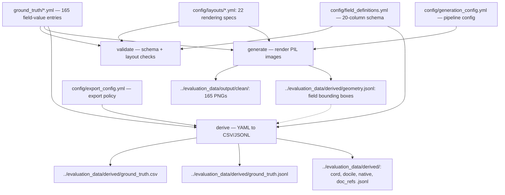

# Synthetic Business Document Generator

YAML-driven pipeline for generating synthetic Australian business documents with ground truth that is authored rather than annotated — values are drawn on the page verbatim, and per-field bounding boxes are recorded at draw time (clean renders only). Produces 165 clean images across 3 document types — bank statements, receipts, invoices — plus 165 degraded receipts (55 receipts × 3 severity tiers), with transaction-linking ground truth.

---

## Quick Start

```bash
# All generated content is written to ../evaluation_data/ beside this repository, which
# must exist first (validate refuses without it).
mkdir ../evaluation_data

# Check every entry before rendering: required fields, ABN checksums, date and
# amount formats, line-item/transaction list parity, GST arithmetic, that each
# layout reference exists, that no text overflows its budget, that no distractor
# value reproduces a scored value, and that the business-name grammar cannot emit
# a real company. Fails fast, listing every problem.
python -m generators.pipeline validate

# Render the 165 clean images into ../evaluation_data/output/clean/, and capture each field's bounding
# box at draw time into ../evaluation_data/derived/geometry.jsonl. Filenames keep the layout
# (CASE001_<layout>.png). No degradation here; that belongs to `eval-set`.
python -m generators.pipeline generate

# Generate only one document type
python -m generators.pipeline generate --type receipts

# Render with distractors drawn, for visual review, into
# ../evaluation_data/output/<distractor_output_subdir>/<type>/ (distractor_output_subdir is set in
# config/generation_config.yml). Writes no clean images and no geometry.
python -m generators.pipeline generate --distractors

# The same distractor pages with their ABN, GST and total labels varied per case (labelled, a variant
# wording, or no label), into ../evaluation_data/output/<labelled_varied_output_subdir>/<type>/, each
# type directory with its label_styles.jsonl sidecar.
python -m generators.pipeline generate --distractors --label-variation

# Re-project the ground truth into ../evaluation_data/derived/: ground_truth.csv and .jsonl, plus the
# benchmark schemas listed in export_config.yml's `export_targets` — cord.jsonl,
# docile.jsonl, native.jsonl, doc_refs.jsonl. DocILE needs the bounding boxes
# `generate` captures, so run that first on a fresh clone.
python -m generators.pipeline derive

# Export the deliverable: one dated snapshot, ../evaluation_data/snapshot_<YYYYMMDD>/, ready to
# upload as is. Four paired halves of 165 images each (plain, distractor, labelled_varied, degraded),
# the clean halves' geometry, every half's OmniDocBench parsing ground truth, the tools, a README
# generated from MANIFEST.json, and SHA256SUMS. What produced it (commit, input hashes, any
# working-tree patch) goes beside it, in snapshot_<YYYYMMDD>.provenance/, which is never uploaded.
# Run validate first. A snapshot of the same date is replaced.
python -m generators.pipeline eval-set

# Check a snapshot against its own manifest (standard library only; also runs on the receiving host).
python ../evaluation_data/snapshot_<YYYYMMDD>/tools/verify_snapshot.py
```

### The evaluation snapshot

`eval-set` is the whole procedure. One command renders every document from the working tree and
writes one directory under `eval_set.output_root` (`../evaluation_data`, a required key in
`config/generation_config.yml`; it must already exist and lie outside the repository), stamped with
today's date:

```
snapshot_<YYYYMMDD>/
  README.md                    generated from the manifest, for a reader with no repository access
  MANIFEST.json                date, halves, counts, tiers, label-style counts, parsing files, every SHA-256
  SHA256SUMS                   the same hashes, for `shasum -a 256 -c SHA256SUMS`
  tools/                       verify_snapshot.py, check_extractions_match_gt.py, score_extractions.ipynb
  plain_<YYYYMMDD>/            165 images, 3 types, ground_truth.csv and .jsonl
  distractor_<YYYYMMDD>/       the same filenames and ground truth, with distractors
  labelled_varied_<YYYYMMDD>/  the same again, labels varied, plus label_styles.jsonl
  degraded_<YYYYMMDD>/         55 distractor receipts x 3 tiers, their own ground truth
  geometry/                    plain.jsonl, distractor.jsonl, labelled_varied.jsonl (scored boxes)
  parsing/                     plain.json, distractor.json, labelled_varied.json, degraded.json: one
                               OmniDocBench page per image, for the evaluator commit the README names
snapshot_<YYYYMMDD>.provenance/
  PROVENANCE.json              commit, dirty flag and changes, input hashes, library versions, metrics,
                               MANIFEST.json's own SHA-256, and the earlier snapshot it follows
  working_tree.patch           only when the tree was modified: exactly what differed from the commit
```

**The snapshot is what gets uploaded, and only the snapshot.** It goes to a bucket that hosted models
read, so it says what the data is and how to use it, never how it was produced. Before it is
published, every file name and every non-image file in it is scanned for the terms under
`eval_set.forbidden_terms` (the repository, the command, the input files, the libraries), and a single
hit refuses the export. The provenance directory beside it keeps everything needed to reproduce it.

No prior `generate` is needed: all four halves come from one render pass, so a degraded variant is
the very same document as the distractor receipt it photographs, never an independent re-roll. The
export runs every render check (density, drawn fields, overlay, label unambiguity) and publishes
nothing unless all pass; it builds in a hidden staging directory and swaps it into place only at the
end, so a refused or interrupted export leaves any earlier snapshot as it was.

**A modified tree.** The export never refuses uncommitted changes (so config can be edited on a
sandbox and exported there); it records them. `PROVENANCE.json` says `dirty: true` and lists under
`working_tree_changes` every path `git status --porcelain --untracked-files=all` reports (changed
tracked paths and untracked, not-ignored ones), each with its status code and the SHA-256 of its
content (or `deleted`). Beside it, `working_tree.patch` holds `git diff HEAD --binary` plus each
untracked file as a new-file diff, so `git apply` on the recorded commit reproduces the tree. The
state is read again before publishing:
a tree that changed during the export (an edit, a commit, a revert) fails with a diagnostic and
publishes nothing, since the snapshot would mix two states.

**Pairing.** The three clean halves share filenames and byte-identical ground truth, so they join
directly on the filename: plain against distractor isolates the distractor effect, distractor
against labelled_varied the label effect. The degraded half holds receipts only (55 receipts x the
three tiers under `receipt_degradation:`), named with the tier suffix; `CASE001_receipt_v2.png`
pairs with `CASE001_receipt.png` once the suffix is removed. A degradation comparison therefore runs
over the 55 receipts only, or document type is confounded with image quality.

Filenames are deliberately generic (`CASE001_bank_statement.png`, never one naming the layout), so a
model cannot infer the template before reading a pixel.

**The manifest.** `MANIFEST.json` serves integrity (every file's SHA-256; `verify_snapshot.py` also
fails on a missing or extra file or a wrong count), provenance (the generator commit, whether the tree was modified, and the hash of
every tracked file under `config/` and `ground_truth/` and of `environment.yml`) and comparability
(two scores are comparable only when they come from the same manifest). The heavy (`_v3`) tier is not
bit-reproducible: its fold noise comes from a generator no seed reaches, so the snapshot itself, not a
regeneration, is the record. The manifest cannot vouch for itself; `eval-set` prints its SHA-256.

### Extraction ground truth as a standalone CSV

`derive` emits this repo's own 165-row `../evaluation_data/derived/ground_truth.csv`. To build an
**extraction CSV** separately from a full `eval-set` snapshot (against an existing image
directory, say), use:

```bash
python scripts/generate_extraction_gt.py \
    --output   /path/to/evaluation_data/<dataset>/ground_truth_extraction.csv \
    --data-dir /path/to/evaluation_data/<dataset>   # optional: validates filenames
```

No other checkout is needed. The columns and value formatting come from
`config/extraction_schema.yml` — the **extraction** contract, defining what a model
is asked for and scored on.

That is a different file from `config/field_definitions.yml`, the **generation**
contract describing what the renderers draw. They differ deliberately: bank
statements carry `ACCOUNT_BALANCE` and `TRANSACTION_DESCRIPTIONS` when generated but
are a 5-field extraction task; receipts show no payer, yet `PAYER_NAME` and
`PAYER_ADDRESS` are still scored, because the prompt asks for them and the right
answer is `NOT_FOUND` — that is how a hallucinated payer gets caught. Pass the
generation contract by mistake and the script refuses with a diagnostic rather than
emitting a wrongly-shaped CSV.

`--data-dir` is worth passing: it warns when a generated filename is missing from the
image directory, which is how you catch ground truth and images having drifted apart.

### Scoring a model against that ground truth

`score_extractions.ipynb` reads a model's `raw_extractions.jsonl` plus a ground-truth
file and reports F1 per extraction field, by document type, macro and micro — plus the
distribution those means are drawn from, a field × document-type heatmap, and an
optional paired comparison of two runs over the same documents, which is how you
measure what degradation cost. It imports nothing from this repo or LMM_POC — pandas,
matplotlib, seaborn and the standard library only — so it runs here with no other
checkout. Set the paths and the per-document-type field lists in its config cell; the
field lists must match the prompt your model was given, since that is what defines a
fair scoring set. Figures are saved to `figures/` at 300 dpi as well as drawn inline.

When inference runs on a remote GPU host and scoring happens locally,
`docs/remote_extraction_runbook.md` covers the round trip: verify the snapshot, send the images
up, keep the ground truth, sidecar and geometry here, bring back one `raw_extractions.jsonl` per
half. Every snapshot ships the notebook (outputs cleared) and the preflight in its `tools/`. Run
`scripts/check_extractions_match_gt.py` on whatever comes back before scoring it: it
fails loudly when a run and a ground truth describe different image sets, which the
notebook itself would otherwise absorb as "unmatched" and score around.

### Scoring document parsers against the parsing ground truth

The snapshot's `parsing/` files score document parsers (MinerU, Docling, Marker) with the pinned
OmniDocBench evaluator: text, table and reading-order accuracy, broken down by document type,
degradation tier and layout. Every parser runs locally from its own conda env (`envs/*.yml`); none of
their packages enters `environment.yml`. `docs/parsing_benchmark_runbook.md` covers it end to end:
building the evaluator and each parser's env, `scripts/run_local_parser.py` (one tool over one half),
`scripts/collect_predictions.py` (one `<image stem>.md` per page), `scripts/score_parsing.py` (the
leaderboard, `../evaluation_data/leaderboard_<YYYYMMDD>.md` and `.csv`), and the licence terms that
govern publishing each tool's scores.

### Dependencies

```
Pillow                  # Image rendering
numpy                   # Array maths for degradation (<=2.4, capped by numba)
PyYAML                  # YAML parsing
typer                   # CLI framework
rich                    # Coloured console output
Faker                   # Fictional en_AU people and addresses
opencv-python-headless  # Camera-scan degrade/rectify (cv2 perspective warp)
augraphy                # Receipt ink/paper damage (installed by scripts/post_install.sh)
apted                   # MIT tree-edit-distance backend for CORD scoring
rapidfuzz               # Fuzzy string matching
docile-benchmark        # Published DocILE KILE/LIR scorer (self-score check)
```

All dependencies are declared in `environment.yml` (conda env `synthetic`), except `augraphy`, which `scripts/post_install.sh` installs and pins.

**Building your own environment** — another team, a new machine, CI:

```bash
conda env create -n synthetic -f environment.yml
conda activate synthetic
bash scripts/post_install.sh          # REQUIRED — see below
```

The post-install step installs `augraphy`, which receipt degradation (and so `eval-set`) needs. `augraphy` declares the full GUI `opencv-python` as a hard dependency, which would **displace the pinned `opencv-python-headless`** (both provide `cv2`) and, on a host without GUI libraries, make `import cv2` fail with `libGL.so.1: cannot open shared object file`. A conda YAML cannot express a per-package `--no-deps`, so `augraphy` is not in `environment.yml`: `scripts/post_install.sh` installs it with `--no-deps`, holds its version pin, removes the GUI build from an older environment, and verifies the result. It is idempotent; run it after every `conda env create` or `conda env update`. `environment.yml` also carries no `name:` or `channels:` key by design: a `name:` conflicts with `--prefix` installs, and a `channels:` key would override the host's mirror configuration and break locked-down environments.

Three packages — `apted`, `rapidfuzz`, `docile-benchmark` — back the local CORD/DocILE scoring tests only. Nothing in `generate`, `derive` or `eval-set` imports them, so they can be omitted when provisioning a generation-only host.

---

## What It Produces

| Output | Count | Description |
|--------|-------|-------------|
| Clean PNGs | 165 | Rendered documents, drawn from the ground truth verbatim |
| Degraded PNGs | 165 | Simulated phone photos with noise, blur, rotation, JPEG artifacts |
| Ground truth YAML | 3 files | Field-level truth for all 165 documents |
| Transaction links YAML | 1 file | 110 receipt/invoice-to-bank-statement links at 3 difficulty levels |
| Derived CSV | 1 file | Flat CSV with all 21 columns (image_file + 20 fields; NOT_FOUND for inapplicable fields) |
| Derived JSONL | 1 file | One JSON object per document with all field values |
| Geometry JSONL | 165 records | Per-document field bounding boxes (relative coords), captured at draw time during `generate` |
| CORD JSONL | 110 records | Receipts + invoices as CORD Donut-style `gt_parse` value trees |
| DocILE JSONL | 55 records | Invoices as DocILE KILE + LIR fields with bounding boxes |
| Native JSONL | 55 records | Bank statements in a project-defined schema |
| doc_refs JSONL | 110 records | Receipt/invoice-to-bank transaction links in FinBalance-style `doc_refs` |

## Document Types (165 entries)

| Type | Count | Layouts | Fields | Example Layouts |
|------|-------|---------|--------|-----------------|
| Bank Statement | 55 | 8 | 9 | 2 per bank (CBA, Westpac, NAB, ANZ) |
| Receipt | 55 | 6 | 12 | Thermal 80mm/57mm, retail tax, fuel, professional, hospitality |
| Invoice | 55 | 8 | 14 | Standard, GST-inclusive, high-value, mixed, trade, professional, wholesale, subscription |

---

## Pipeline CLI

```
python -m generators.pipeline <command> [OPTIONS]
```

| Command | Description |
|---------|-------------|
| `validate` | Required fields, layout references, ABN checksums, date/amount formats, parallel-list parity, GST arithmetic, DSL layout bodies, fit-overflow backstop, distractor density bounds, every entry's distractor values, and that the name grammar cannot emit a real business |
| `generate` | Render document images from ground truth + layouts, plus `../evaluation_data/derived/geometry.jsonl` |
| `derive` | Regenerate CSV/JSONL and the benchmark projections from ground truth YAML |
| `eval-set` | Export one dated snapshot of four paired halves with its manifest, README and tools |

| Flag | Default | Applies To | Description |
|------|---------|------------|-------------|
| `--config` | `config/generation_config.yml` | all | Path to generation config |
| `--type` | all types | generate | Generate only this document type |
| `--distractors` | off | generate | Render with distractors into `<output_dir>/<distractor_output_subdir>/<type>/` instead of `clean/`; no geometry is written |
| `--label-variation` | off | generate | With `--distractors` only: render each page labelled varied into `<output_dir>/<labelled_varied_output_subdir>/<type>/`, with a `label_styles.jsonl` sidecar per type directory |

### Distractors

A distractor is a value printed on the page that a model must not extract: a store number, an ACN
beside the ABN, a due date beside the invoice date, a handwritten total on a bank statement. The
catalogue lives in `config/distractors.yml`: each item's document types, its kind (`clutter`,
`near_miss` imitating a scored `target`, or `repeat` copying a scored `field`), the `DX_` key it
emits, the items it `requires`, and the value rule it is drawn with. The same file sets how many items
a document draws (`selection`), the redraw budget (`max_redraws`) and the screen's settings
(`validator`). Every key is required; there are no Python defaults.

Distractors are drawn only when a render asks for them: every renderer takes a required `distractors`
flag, and with `distractors=False` no distractor provider runs, no `DX_` key reaches the entry and the
page is exactly as it was before distractors existed. `generate` and `eval-set` render with the
flag off; `generate --distractors` turns it on for visual review, writing each document under its plain
filename to `<output_dir>/<distractor_output_subdir>/<type>/` (`distractor_output_subdir` is a required
key of `config/generation_config.yml`) and writing no geometry, since scored boxes come from the plain
renders. The overflow backstop in `validate` renders every entry plain, and again with distractors when
its layout carries a distractor provider, so a distractor value that would not fit its box fails there
too, naming the mode that overflowed. With it on, each value is screened before it is drawn: a near-miss
must not equal its target, a repeat must equal its field exactly, and no value may contain any scored
value. A colliding value is redrawn up to the budget, then the render fails with a diagnostic naming
the case, the item and the field; an item whose rule cannot vary (a fixed value, a count, a sum) is
dropped for that case instead, with every item that requires it. A value no redraw can change (a
repeat, or a website, handle or survey address fixed by the supplier name) fails on the first
collision, and one caused by the supplier name itself names SUPPLIER_NAME in its advice. Each rule's
parameters are checked when the catalogue loads.

A layout opts in by listing the items its blocks draw under `distractor_items:` and adding its document
type's distractor provider (`receipt_distractors`, `invoice_distractors` or `bank_distractors`, no
params) to `field_providers:`; the provider draws from that list, the only copy. `validate` refuses a
list without the provider, a provider for another document type, and a provider with fewer listed
items than the type's minimum `selection` count.

Each block drawing a `DX_` key is gated with `when:` on one `DX_` key. It may draw that key and any key
whose item the gate's item `requires`, directly or through other items, since the provider never draws
an item without its requirements: a survey QR code gated on `DX_SURVEY_URL` may caption
`{DX_SURVEY_CODE}`, but not the other way round. A `barcode` bound to a `DX_` key carries that one
placeholder alone, uses `code128`, and must draw an item whose rule is `digits` with an empty prefix and
an even length of at most 16; `validate` also checks its worst case (the widest digit string of that
length, measured in the caption's own face, since a handwritten face such as Kalam has digits of
different widths, with the block's `module_px`, `quiet_zone` and caption) fits the layout's
`content_width`.

Which items a document draws comes from one seed per case and document type; each item's value comes
from its own seed per case, document type and item, so a value never depends on which other items were
selected. `validate` checks every entry's distractor values: it draws every catalogue item eligible for
the entry's document type, which yields exactly the values any real selection would draw, and runs the
value validator over the result, so a catalogue or ground-truth edit that would let a distractor
reproduce a scored answer fails there.

While a page is drawn, the geometry recorder also keeps the ink of every text line and code mark with a
role: `scored` for a block or table cell carrying `field:` (a pair's label stays `text`; only its value
is scored), `distractor` for a block gated with `when:` on a `DX_` key (and everything nested inside
it) or whose text references one, and `text` for everything else. Rules (a row of dashes or a thin
line) are not ink. A barcode, QR code or logo records its drawn rectangle, symbol and caption together,
as a distractor mark, and its caption also as a line of distractor text. A code mark is never scored, so
`validate` refuses one that is not gated on a `DX_` key, by its own `when:` or an enclosing container's.
A distractor render always records its ink, with or without `geometry_out`; a caller that needs it
without the scored geometry passes the renderer an `ink_out` list. A plain render records ink only when
asked. The ink is internal: it is written nowhere, and `geometry.jsonl` and every export still carry
scored field boxes only. From it,
`generators/distractors/density.py` measures three figures per render: the scored-ink ratio (scored
ink area over all text ink area), the distractor share (distractor text area over all text ink area;
code marks are left out of both) and page fill (lowest ink over page height). `config/distractors.yml`
bounds them per document type under `density:` with three required keys, each a fraction from 0 to 1:
`scored_ink_ratio_max`, `distractor_share_min` and `page_fill_min`. A plain render has no distractor
text, so a render meeting a share floor above zero is known to carry distractors. `page_fill_min` may
instead be an explicit `null`, meaning unbounded, for a page cropped to its content: a receipt ends
where its last line does, so its fill is near 1 by construction and says nothing; a missing key is still
refused. `validate` refuses a distractor render of a layout carrying a distractor provider that falls
outside the bounds, naming the case, layout, metric, value and bound; it measures each
such render during the overflow pass, so every page is rendered once per mode. Plain renders are the
control: they are measured, never bounded.

Every receipt layout draws distractors. The shared receipt body places each of the fourteen receipt
items where a real receipt prints it, and every layout lists all fourteen but the cafe's hospitality layout,
which lists neither the returns-by date nor the returns policy (a cafe takes no returns) and draws its body
without them: a generated logo, ACN, store number, merchant ID, phone and
website in the header; a transaction ID on the POS line; an item count under the line items; "You
saved" centred under the total (3% to 25% of it, from the `amount_fraction` rule, so always less);
member number and points balance below the totals; and in the footer a returns-by date, the returns
policy, a Code 128 barcode of the transaction ID (its digits printed `caption_gap` px below the bars)
and a survey QR code with its survey code on a line of its own. Distractor text fits through each
layout's `DISTRACTOR_LINE` and `DISTRACTOR_PARAGRAPH` budgets, sized to its content width (294 px on the 57 mm page), never through a
scored field's budget. The receipt density bounds were measured on these renders.

Every invoice layout draws distractors too, 14 to 22 items per page. The four general layouts (standard,
GST-inclusive, high-value, mixed) share one body; the four industry layouts (trade, professional,
wholesale, subscription) each have their own, laid out around what that kind of business prints (a
licence number and site address, a matter number and terms of engagement, a ship-to address and
delivery docket, a billing period and direct-debit notice). Every near-miss prints under its own label
("Due date", "Date of supply", "Ship To", "Previous balance", "Principal" and so on), never a scored one.
The invoice half of `config/distractors.yml` adds these keys, each required:

- `states:` names a per-document state and the items each of its values prints. An invoice is `paid`
  (the amount paid and a nil balance due) or `unpaid` (the remittance slip, anchored on the amount due,
  and an account summary), drawn per case on its own seed; items of the other value, and items requiring
  them, are never selected. Receipts and bank statements declare `{}`. A layout drawing a type's
  distractors must list every item of every state value.
- `exclusive:` lists sets of items no page prints together, one kept per document on its own seed: a
  direct-debit notice and a remittance slip (a customer paying by direct debit posts no slip).
- A container may carry `anchor: foot`, which draws it upward from the bottom margin, so the invoice
  footer (thank-you line, website and social lines, remittance slip, page number) sits at the foot of
  the page however long the body is; a footer that would reach up into the body fails fast. The `stack`
  primitive groups blocks under such an option and draws exactly what its children would.
- The unpaid account summary is a panel of its own, never in the totals column, and it adds up: the
  previous balance, the payment that cleared it, this invoice and the amount due (both the invoice
  total). The previous balance requires the summary, so it never prints outside it.

Every bank statement layout can draw three inline distractors (a statement draws two to four of its
seven items, so some draw none of these three), each where a real statement prints it and beside a line
the page already carries, so no scored value moves: the issue date under its own "Statement issued"
label on the statement-period row (a near-miss for the period, one date and never a range; NAB prints
its labelled statement period on the account box's third row and the issue date on the box's heading
row, clear of it by row and by label), a mail-sort Code
128 barcode with no digits beside the account-holder lines, and a promotional message in a bordered
panel drawn up from the bottom margin (`anchor: foot`). A statement is one fixed-height page, like an
invoice: both renderers refuse a body that ends below `page_dimensions.height - margin`, naming the case,
the layout, the render mode and the overrun.

Content is keyed to the business. Each invoice layout declares the `service_categories` its design fits
and each receipt layout the `merchant_categories` it serves (both in `config/layouts/`); the seed draws a
case's category from its layout's list (or, for a receipt, a layout serving the merchant's category) and
stores it beside `layout:` as non-scored metadata, `service_category` on an invoice and
`merchant_category` on a receipt, declared under `entry_metadata` in `config/field_definitions.yml`.
`validate` checks it against the layout's list; no derived or exported view carries it. In
`config/data_pools.yml`:

- `category_catalog` holds each service category's invoice lines and `product_catalog` each merchant
  category's receipt lines, each with a billing `quantity` range; the seed draws one to four lines in
  drawn order, so no line leads every invoice of its category, and `validate` refuses an invoice layout
  category without lines.
- `category_industries` maps every service category to an industry, and the clutter pools under
  `distractor_text` that are mappings (tagline, accreditation, services, warranty, terms) are keyed by
  industry, so an accounting firm never advertises fleet servicing.
- `real_brand_blocklist` lists well-known brands that no catalogue line, name noun or pool text may name,
  and distractor text is screened against it when drawn. `catalogue_only_brands` lists brands that are
  also common names (a surname, a street), screened against product and service descriptions only.
  `brand_screen` sorts every top-level pool into `screened` or `exempt`; the exemptions are deliberate,
  among them the payment chrome a real terminal prints (card schemes, wallets, acquirers) and the banks.

The invoice rules add value types: `bank_account` and `bpay` each draw a pair of values printed on two
labelled lines (a BSB never prints without its account number); `state_text` draws its wording from the
text pool of the document's state (a direct-debit notice in the past tense on a paid invoice);
`amount_ratio` scales a money near-miss to a scored amount (`element: whole` for a total, `max` for the
dearest unit price of a list) between two ratios, with a required `cap` (`none`, or a `{min, max}` range
for a figure printed inside a sentence); `month_period` prints a calendar month beside the invoice date;
and `address` and `po_box` take a required `state_of`, the scored address whose state they are drawn in
(a site address near the payer, a remittance PO Box in the supplier's own state), or `any`.

The invoice density bounds depart from the spec's starting 0.25: the median sampled page has a scored-ink
ratio near 0.25, but a sparse page reaches about 0.43, so the ceiling is set from measurement with
headroom (`config/distractors.yml` records the figures).

#### The overlay layer

Some distractors are not printed by the document's own software but added to the paper afterwards: a
PAID stamp, a taxpayer's highlighter and pen. These are overlay marks, drawn by `generators/overlay/`
on the finished page of a distractor render, after the body and before anything else touches the image
(degradation, export). A plain render never draws one. Every layout carries a required `overlay:` list,
`overlay: []` when it draws none; a block names its `type` (a registered overlay primitive), is gated
with `when:` on a `DX_` key one of the layout's `distractor_items` emits, and may name further `DX_`
keys only where its gate's item requires theirs, as for body blocks. Whether a document type carries an
overlay at all is the YAML's to say: `overlay.protect` gives receipts `no_overlay` (a receipt is cropped
to its content after drawing), so `validate` and the renderer refuse a non-empty receipt `overlay:`.

Each block's marks are composited onto the page and then verified, failing fast with a diagnostic that
names the case, the layout, the block (`<layout>.overlay[n]`), the mark's box and every box it met:

- No opaque overlay pixel may lie inside a protected ink box padded by `overlay.clearance_px`. The test
  is on drawn pixels, not the mark's bounding box, so a loop may ring an amount it does not touch. What is
  protected is declared per document type under `overlay.protect`: `scored_and_marks` (scored values and
  every barcode, QR code and logo) on invoices, `all_ink` (every recorded line and mark) on bank
  statements, whose scored transaction dates record no box of their own.
- No mark may come nearer a page edge than `overlay.page_inset_px`.
- A translucent tint (highlighter) is multiplied over the page once, and every ink box it meets is held
  to the WCAG contrast ratio `overlay.contrast.min_ratio`, read between two luminance percentiles of the
  box: a scored box always, any other box if it met the ratio before the tint.

Overlay ink is distractor ink, recorded before the renderer hands back its geometry, so density is
measured on the composited page: stamped and handwritten text counts as distractor text, strokes
(ticks, loops, underlines) as distractor marks, and a tint as nothing, being a wash over text already
counted. What an overlay draws comes from catalogue values; how it draws them (placement order, colour,
rotation, jitter) comes from each block's own seed, `sha256("{case_id}:overlay:{doc_type}:{block_index}")`,
so adding a block moves no other value or mark. A mark with no legal place fails the render, and
`validate` collects every such refusal, each with its whole diagnostic.

**The PAID stamp.** Every invoice layout carries one `stamp` block, gated on `DX_PAID_STAMP`:

```yaml
overlay:
  - {type: stamp, when: DX_PAID_STAMP, content: "{DX_PAID_STAMP}", date_key: DX_PAID_DATE,
     candidates: [{x: 0.72, y: 0.15}, {x: 0.66, y: 0.10}, {x: 0.68, y: 0.19}, {x: 0.55, y: 0.40}]}
```

Its word comes from `in_paid_stamp`, a `pick` rule drawing one of `[PAID, PAID IN FULL, RECEIVED]` on
the item's seed (screened like any clutter; a collision redraws). Its date line, printed when
`in_paid_date` is drawn too, is a `repeat` of INVOICE_DATE drawn by `link_date`: the bank date of the
transaction that paid the case's invoice in `ground_truth/transaction_links.yml`, which fails fast when
the invoice has no link or more than one. Every corpus link's bank date equals its invoice date, and the
repeat check pins that: a reseed that pays invoices later fails there. Both items belong to the paid
group of the payment state, so a stamp never shares a page with a remittance slip or account summary.
`date_key` is an optional key: the stamp draws with or without it, so the gate need not cover it, but its
item must require the stamp's item (`none` drops the date line). `candidates` are centres, as page
fractions, where a clerk stamps: beside the title and invoice details, across the upper body, or over the
totals panel. The word and date are set in `overlay.stamp.font` inside a bordered frame on their own
layer, in a colour, opacity, rotation and speckle (ink knocked out) drawn on the block's seed from
`overlay.stamp`; candidates are tried in an order drawn on that seed, and the first whose rotated
footprint, frame included, stays inside the page inset and clears every padded scored box and code mark
is used. `validate` refuses a candidate outside [0, 1], one whose largest footprint (widest word and date
at the largest rotation) cannot fit inside the page inset, and a stamp whose item is not in the paid group.

**A taxpayer's annotations.** Every bank layout carries four overlay blocks, drawn in this order so ink
lies over the tint:

```yaml
overlay:
  - {type: highlight, when: DX_ANNOTATED_ROWS, rows: DX_ANNOTATED_ROWS,
     row_fields: [TRANSACTION_DESCRIPTIONS, TRANSACTION_AMOUNTS_PAID]}
  - {type: ink_marks, when: DX_ROW_MARKS, rows: DX_ANNOTATED_ROWS, marks: DX_ROW_MARKS,
     target_field: TRANSACTION_AMOUNTS_PAID, kinds: [tick, circle, underline], tick_lane: left_margin}
  - {type: handwriting, when: DX_MARGIN_NOTE, content: "{DX_MARGIN_NOTE}", rows: DX_ANNOTATED_ROWS,
     description_field: TRANSACTION_DESCRIPTIONS, column_field: TRANSACTION_AMOUNTS_PAID,
     lanes: [after_description, left_margin, right_margin, below_column]}
  - {type: handwriting, when: DX_ANNOTATION_TOTAL, content: "= {DX_ANNOTATION_TOTAL}", ...,
     lanes: [below_column]}
```

The owner marks the expenses they claim: `bk_annotated_rows` draws the rows linked to the case's receipt
and invoice in `ground_truth/transaction_links.yml` plus one to three more debit rows, as ground-truth row
positions; `bk_row_marks` gives each one a pen mark (`tick`, `circle` or `underline`, a `row_marks` rule);
`bk_margin_note` draws a note from the `margin_note` pool; `bk_annotation_total` is the correct sum of the
annotated rows. Rows are found on the page by their recorded scored boxes, never by counting lines (the
table may print an opening balance, date rows or credits between them), and widened to the whole printed
row. The highlighter is one translucent band per row, its ends leaning by a seeded amount, every band
drawn into one mask and multiplied over the page once, so text stays dark and overlapping bands darken
once; every highlighted box is then held to the contrast threshold, read between the box's paper and the
darkest of its ink pixels (so a one-glyph value reads its glyph, not its paper). A tick sits in the left
margin level with its row, a loop rings the paid amount clear of its padded box, an underline runs just
beneath it; strokes are jittered, tapering polylines drawn at four times the page resolution. Notes and
the sum are written glyph by glyph, each glyph's size, slant and baseline jittered, in one of the vendored
handwriting faces (Kalam and Caveat, regular and bold; Indie Flower; Patrick Hand), sized by x-height so
every face writes at one scale. A note goes in the first clear lane, trying every row's own lanes (after
its description ink, in a margin) before the space under the paid column below the table; the sum goes
under the paid column. One hand and one pen per statement, each drawn on a page seed
(`sha256("{case_id}:overlay:{doc_type}:hand")`, `...:pen`), so every mark on a page is one person's.
Settings live under `overlay.highlighter`, `overlay.ink` and `overlay.handwriting`; `validate` refuses a
block whose `kinds` miss a kind the rule can choose, whose `rows` or `marks` is not a key of the gate's
item or one it requires, whose lane is unknown, or whose field is not recorded by the layout's table, and
it refuses any distractor render that records no distractor ink or mark (a page carrying highlighter
alone, which records nothing, cannot pass).

#### Label variation

A third render, `labelled_varied`, asks whether a model reads a value or only its label. From identical
ground truth and identical distractors, each receipt and invoice prints its ABN, GST and total labels in
one of three styles per case: `labelled` (the wording the layout prints today), `variant` (another
wording from the site's pool, such as `ABN No.`, `Includes GST of` or `Total payable:`) or
`unlabelled` (the value alone). Bank statements print none of the three labels, so their labelled varied
page is their distractor page, byte for byte. Plain and distractor renders always print the labelled
wording and are unchanged.

Everything is declared in YAML. Each receipt and invoice layout names its label sites in a
`label_styles` field provider: per field, the `labelled` wording (carrying its own punctuation, since a
site's separator is empty, so an unlabelled site prints no stray colon) and the `pool` its variants come
from. A layout wraps its totals in one `stack` with `region: totals`, which draws exactly what its
children would. `label_variation:` in `config/distractors.yml` holds the varied fields per document type,
each field's style weights, the variant pools, the wordings a page in a given state withholds (a paid
invoice never prints `Balance:` over its total, which would read as an amount owing), the words a
collision ignores per field, and the refusal policy.

Each case draws its choices on its own seed, `sha256("{case_id}:labels:{doc_type}")`, as orders: per field
a weighted order of the three styles and a shuffle of the pool, ending in `labelled`. The page is then
read for ambiguity, and a choice a careful reader could misread is refused: an unlabelled ABN beside
another checksum-valid 11-digit number; an unlabelled GST outside the totals region, below the total, or
beside another amount in the region equal to the total divided by 11; an unlabelled total that is not the last
or most prominent amount of the region, or whose size and weight a distractor amount shares; a variant
sharing a word with a distractor line, or meeting other ink; an unlabelled value moved onto its
neighbours. Under `refusal_policy: redraw` the first refused field moves to its next candidate and the
refusal is recorded; under `fail` the first refusal stops the run with a four-part diagnostic.
`labelled` is never refused, so every page renders. `validate` renders every receipt and invoice this way
too, under the drawn-field guard and the density bounds.

`generate --distractors --label-variation` writes the pages to
`<output_dir>/<labelled_varied_output_subdir>/<type>/` (`labelled_varied_output_subdir` is a required
key of `config/generation_config.yml`: one directory name, never `clean` nor the distractor directory)
under the filenames the other renders use, and prints per type how often each style was drawn per field
and how many choices each rule refused. Each type directory gets `label_styles.jsonl`, one row per image
with sorted keys: `image_file`, `case_id`, `doc_type`, `layout`, `styles` (`{FIELD: {style, wording}}`,
the wording as printed and trimmed, `""` when unlabelled; `{}` for a bank statement) and `refusals`
(`{field, rule, style, wording}` each). The sidecar holds nothing from the ground truth beyond the case
id, and `derive`, `eval-set` and the extraction ground-truth script never read it. Without
`--distractors` the flag is refused, and nothing is written.

### Scripts

Everything outside the pipeline itself. The two seeders **rewrite the corpus**; the
three checks are read-only.

| Script | Description |
|--------|-------------|
| `scripts/seed_ground_truth.py` | **Destructive.** Re-seed the 165 ground-truth entries at `seed=42` |
| `scripts/seed_transaction_links.py` | **Destructive.** Re-seed the 110 links, rewriting the three ground-truth files it reads |
| `scripts/check_seed_reproducibility.py` | Assert the committed corpus is exactly what those two produce, run in an isolated copy |
| `scripts/generate_extraction_gt.py` | Build an extraction ground-truth CSV from `config/extraction_schema.yml` |
| `scripts/check_extractions_match_gt.py` | Assert a returned `raw_extractions.jsonl` and a ground truth describe the same images. Stdlib only, so it also runs on the extraction host |
| `scripts/omnidocbench_eval.py` | Clone the pinned parsing evaluator, and score one directory of markdown predictions with it |
| `scripts/run_local_parser.py` | Run one configured parser over one snapshot half from its own conda env, recording the run in `run.json` |
| `scripts/collect_predictions.py` | Turn a parser run's raw output into one `<image stem>.md` per page, refusing missing or doubled pages |
| `scripts/score_parsing.py` | Score every collected run and write the parsing leaderboard |
| `scripts/post_install.sh` | **Required after every `conda env create` or `env update`** — see [Dependencies](#dependencies) |

See [Regenerating the Dataset](#regenerating-the-dataset) for the order the seeders
must run in and what a re-seed invalidates.

---

## Architecture



> `derive` emits the CSV/JSONL always, and each benchmark view (`cord`, `docile`, `native`, `doc_refs`) only when it is listed under `export_targets` in `config/export_config.yml`. The DocILE export reads `../evaluation_data/derived/geometry.jsonl`, which is written by `generate`.

---

## Ground Truth YAML Format

YAML is the single source of truth. Each entry specifies a layout reference, degradation seed, and field values:

```yaml
CASE001:
  layout: receipt_fuel
  degradation_seed: 8967
  fields:
    DOCUMENT_TYPE: RECEIPT
    SUPPLIER_NAME: Ravensdale Health Store   # fully fictional; screened against a real-name blocklist
    BUSINESS_ABN: '79 104 332 181'           # generated, valid checksum (never a real ABN)
    BUSINESS_ADDRESS: '400 Stewart Rd, South Yarra VIC 3141'
    INVOICE_DATE: '02/03/2023'
    IS_GST_INCLUDED: 'true'
    GST_AMOUNT: '1.24'
    TOTAL_AMOUNT: '13.60'
    LINE_ITEM_DESCRIPTIONS: Dishwashing Liquid|Bandaids 40pk
    LINE_ITEM_QUANTITIES: '1|1'
    LINE_ITEM_PRICES: '4.73|8.87'
    LINE_ITEM_TOTAL_PRICES: '4.73|8.87'
```

---

## Content Generation & Guarantees

All ground-truth content is generated from `config/data_pools.yml` through a shared engine (`generators/content_engine.py`), driven by the two seed scripts. The corpus carries three guarantees **by construction**:

### Fictional by construction — nothing real goes in

No real document is ever read, transformed or de-identified: every page is composed from vocabularies and rules, so there is no underlying record to re-identify.

People and addresses come from Faker (`en_AU`); businesses are invented from curated name-parts and paired with generated ABNs (valid checksums). Every generated business name is screened against a **real-name blocklist** — the real retailers/professional services listed in `data_pools.yml` plus a curated list, which exist only to seed that blocklist and are never emitted. Entity selection uses seeded non-repeating sampling, so entities vary and de-correlate across documents instead of repeating in lockstep.

Two things on the page are deliberately real — the **four bank names** that issue the statements, and **suburbs and postcodes** paired with fabricated street numbers. Two residual risks follow from generating plausible values: ABNs are checksum-valid but not registry-checked, and generated person names draw on real name distributions, so coincidence is possible in both cases. Neither involves processing anyone's data. [`docs/generator_capability_overview.md`](docs/generator_capability_overview.md) §8 carries the full account, including why the blocklist is needed at all.

### Deterministic & reproducible

The seed scripts run at `seed=42`, seeding the local RNG, Faker, and the module-global RNG behind `generate_abn`, so re-running them reproduces a **byte-identical** corpus. The dataset is fully regenerable and any change is diffable run-to-run.

### Fit-safe — no silent clipping

Every variable field is drawn through `fit_text` against per-layout pixel budgets (`config/layouts/*.yml` `field_budgets:`, loaded by `generators/layout_budgets.py`): text that doesn't fit **wraps or shrinks losslessly**, and a genuinely impossible fit raises `FitError`. The `validate` command runs an overflow backstop (`generators/overflow_check.py`) across all 3 document types, so no rendered field can silently truncate — a benchmark-corrupting failure fails loudly instead.

`config/data_pools.yml` is the single source of content (fictional business name-parts, Faker config, product/service catalogs, bank-description grammar, street types, category partitions, and the real-name blocklist). Python holds no content constants; a missing pool key fails fast with a diagnostic.

---

## Benchmark Export Schemas

Beyond the flat `ground_truth.csv`/`.jsonl`, the `derive` command re-projects the corpus onto standard document-AI benchmark schemas so results are comparable to public leaderboards. The mapping code lives in `generators/exporters/` and the policy in `config/export_config.yml` (every key required, no silent defaults).

The authoritative field maps and worked examples are in [`docs/GroundTruth_Export_Spec.md`](docs/GroundTruth_Export_Spec.md) (normalisation §3, CORD §4, DocILE §5, doc_refs §6, native §7). Each exporter module's docstring cites the spec section it implements.

| Target | File | Scope | Schema |
|--------|------|-------|--------|
| `cord` | `../evaluation_data/derived/cord.jsonl` | Receipts + invoices (110) | CORD Donut-style `gt_parse` value trees. Fields with no CORD slot (supplier, ABN, address, date, payer) go under an `extension` subtree |
| `docile` | `../evaluation_data/derived/docile.jsonl` | Invoices only (55) | DocILE KILE + LIR fields, each with a bounding box from `geometry.jsonl` |
| `native` | `../evaluation_data/derived/native.jsonl` | Bank statements (55) | Project-defined schema for types with no public equivalent |
| `doc_refs` | `../evaluation_data/derived/doc_refs.jsonl` | Transaction links (110) | FinBalance-style cross-document `doc_refs` |

Which targets are emitted is controlled by `export_targets:` in `config/export_config.yml`. To ship a target as a no-op, remove it from that list. Do not delete the key.

### Export policy (`config/export_config.yml`)

| Key | Purpose |
|-----|---------|
| `abn_tfn_canonical_form` | Form emitted in `text` (`spaced` — what the renderer draws, so what a VLM reads) |
| `abn_tfn_equality_form` | Form used for internal equality checks (`digits_only`) |
| `cord_extension_scoring` | Whether the `extension` subtree counts toward the headline CORD score (`excluded_scored_separately` keeps the number leaderboard-comparable) |
| `export_targets` | List of derived views to emit |
| `docile_fieldtypes` | Ground-truth column → DocILE field-type map (verified byte-exact against `rossumai/docile`) |

### Scoring

The export layer ships self-scoring so the mappings are provably lossless:

- **CORD** — `generators/exporters/cord_eval.py` is a vendored, `apted`-backed port of Donut's `JSONParseEvaluator` (MIT `apted` replaces the GPL-adjacent `zss`; original Donut MIT licence reproduced in-file). `cord_score.py` applies the `cord_extension_scoring` policy.
- **DocILE** — scored via the published `docile-benchmark` KILE/LIR scorer; the test suite asserts a perfect self-score and that corrupting a single box or field-type degrades only the expected metric.

---

## Transaction Links

`ground_truth/transaction_links.yml` maps receipts and invoices to bank statement debit transactions at three difficulty levels:

| Difficulty | Criteria | Count |
|------------|----------|-------|
| Easy | Exact date and amount match | 52 |
| Medium | Amount match, date offset 1-3 days | 36 |
| Hard | Amount match, date offset 3-7 days | 22 |

```yaml
# Keys are image filenames; source and target share the same CASE### prefix
CASE001_receipt_fuel.png:
- bank_statement: CASE001_cba_standard.png
  supplier: Ravensdale Health Store
  receipt_date: '02/03/2023'
  receipt_total: '13.60'
  bank_date: '02/03/2023'
  bank_description: VISA DEBIT PURCHASE RAVENSDALE HEALTH STORE Alexandria AU
  bank_amount: '13.60'
  match_status: FOUND
  match_difficulty: easy
  notes: Early row on cba standard — exact date and amount match
```

---

## Linking Validation API

### Transaction Linking (2-document pairs)

```python
from linking.transaction_matcher import parse_amount, normalize_date, description_score
from linking.link_validator import validate_links, LinkScore

# Parse amounts: handles "$1,234.56", negatives, NOT_FOUND
amount = parse_amount("$1,234.56")  # 1234.56

# Normalize dates: DD/MM/YYYY, DD/MM/YY, DD Mon YYYY, YYYY-MM-DD
d = normalize_date("15/03/2024")  # date(2024, 3, 15)

# Fuzzy description matching (SequenceMatcher)
score = description_score("RAVENSDALE HEALTH STORE", "Ravensdale Hlth Store")  # ~0.95

# Score predictions against ground truth
result: LinkScore = validate_links(ground_truth_dict, predictions_dict)
print(f"F1: {result.f1:.2f}, by difficulty: {result.by_difficulty}")
```

---

## Degradation Pipeline

**Receipts only, at three severity tiers.** Bank statements and invoices reach the business as clean PDFs or printouts, so degrading them would model a workflow nobody has. Receipts are the documents users actually photograph — creased, shadowed, and shot at an angle on a desk.

Degradation is produced by the `eval-set` export, not by `generate`. `generate` writes clean images only.

Each clean receipt is degraded once per tier, so the degraded evaluation set is 55 receipts × 3 tiers = 165 images:

| Tier | Suffix | Models |
|---|---|---|
| light | `_v1` | A good phone photo of a fresh receipt: gentle tilt, even light |
| moderate | `_v2` | A used receipt in poor light: stronger tilt, cast shadow, more compression |
| heavy | `_v3` | Creased and photographed badly, but still legible to a careful human |

### How a variant is built

Augraphy damages the flat page **before** the warp; camera effects apply **after**, to the whole frame:

```
clean receipt (flat)
  ↓  Augraphy ink phase     — ink bleed, faded toner      } damage to the
  ↓  Augraphy paper phase   — creases, lighting, shadow   } paper itself
  ↓  camera warp            — desk, perspective, shadow
  ↓  camera photometrics    — lighting, blur, noise, JPEG } the act of
degraded variant                                          } photographing
```

The ordering is load-bearing: a crease belongs to the paper and must be warped *with* the page. Painting one flat across an already-tilted photo would read as a defect in the image rather than in the document.

The perspective warp uses **OpenCV** (`cv2.getPerspectiveTransform` / `cv2.warpPerspective`) — the same homography a rectification preprocessor inverts. Compositing and photometrics stay in PIL/NumPy, all in RGB order (no BGR swap). Augraphy's own geometric augmentations are deliberately unused: the warp owns geometry, and a second perspective transform would defeat the rectifier's quad detection.

### Configuration

Every parameter lives in `config/generation_config.yml` under `receipt_degradation:`. The tier list *is* the variant count, so the config cannot contradict itself about how many variants a receipt gets. Every key is required — a missing one fails at startup with a diagnostic naming the tier index.

Retuning severity is a YAML edit, never a code change. Only the augmentations listed in `AUGMENTATIONS` (`generators/degradation/augment.py`) may be named; a typo fails against that list rather than at render time.

Determinism comes from each entry's `degradation_seed` combined with the tier's index, so a tier's output is stable and independent of how the tiers are ordered.

**Dependencies:** `opencv-python-headless` (cv2) and `augraphy`. Augraphy declares the full GUI `opencv-python`, so it must be installed `--no-deps` to preserve the headless build; its `numba` dependency also caps NumPy at ≤2.4. Both constraints are recorded in `environment.yml`.

### Rectification — undoing the camera scan (offline preprocessing)

`rectify_camera_scan.py` is the **inverse** of the camera-scan degradation: it detects the receipt quadrilateral on the flat background and applies a 4-point perspective transform to recover an upright, cropped, frontal receipt. It runs **offline** as a preprocessing pass, so the downstream VLM consumes already-rectified images and the inference environment needs no OpenCV.

Pipeline: grayscale → blur → Canny edges → dilate → largest external contour → 4-point polygon → `cv2.getPerspectiveTransform` / `cv2.warpPerspective`. It uses the **same** homography library `generators/degradation/camera.py` warps with. Note the two are approximate rather than exact inverses: the rectifier re-detects the quad from pixels instead of reusing the stored homography, and the blur, noise and JPEG steps are not invertible. This is moot under value-F1 scoring and matters only for spatial round-trip checks. **Fail-open:** if no convincing quad is found (no 4-gon, too small, or too large), the image passes through unchanged — a missed rectification is cheap; a wrong crop that drops a row is a regression.

```bash
# Single image: any input path and output path, here a heavy-tier receipt from a snapshot
python rectify_camera_scan.py \
    ../evaluation_data/snapshot_<YYYYMMDD>/degraded_<YYYYMMDD>/CASE001_receipt_v3.png /tmp/CASE001_receipt_v3.png

# Batch: reads <root>/degraded/receipts/*.png and writes <root>/rectified/receipts/, so lay the
# receipts out that way first (a snapshot's degraded half is flat and is not read by --batch)
python rectify_camera_scan.py --batch <root>
```

On the 55 camera-scan receipts the quad is detected 55/55 (100%), recovering close to the original clean dimensions (e.g. CASE001 clean 420×374 → degraded 516×490 → rectified 425×380). **Dependency:** `opencv-python-headless` (cv2), same as the degrader. Tunable knobs in `detect_document_quad()`: `min_area_frac` / `max_area_frac` (reject spurious tiny / full-frame quads).

---

## Regenerating the Dataset

### Document Generation (CASE001-CASE055)

Both seeders **overwrite `ground_truth/*.yml`**, and they must run in this order — the
second rewrites what the first wrote, so the committed corpus is the fixed point of the
pair, not of either alone. Running the link seeder alone against an already-linked
corpus re-links it and produces a different, self-consistent result.

```bash
# Re-seed ground truth (165 entries, deterministic with seed=42)
python scripts/seed_ground_truth.py

# Re-seed transaction links (110 links across 3 difficulty levels)
python scripts/seed_transaction_links.py

# Confirm the committed corpus is exactly what those two produce
python scripts/check_seed_reproducibility.py
```

A deliberate re-seed invalidates the **content-pinned baselines** — the pixel snapshots
and the derived baseline — which must be re-captured afterwards. Nothing else notices a
reproducibility break: those tests render from the committed YAML rather than from a
reseed, which is why `check_seed_reproducibility.py` exists.

### Generate and Validate

```bash
# Validate all ground truth against schema
python -m generators.pipeline validate

# Generate all 330 images
python -m generators.pipeline generate

# Regenerate derived CSV/JSONL
python -m generators.pipeline derive
```

---

## File Structure

```
rectify_camera_scan.py         # Offline rectification: detect quad + 4-point transform (inverse)

generators/
├── __init__.py
├── common.py                  # Fonts, text helpers, ABN validation, GST, fit_text
├── degradation/               # Receipt degradation — tier config, Augraphy registry, camera warp
├── content_engine.py          # Shared content generator (Faker en_AU, fictional business, blocklist, seeded sampling)
├── layout_budgets.py          # Per-field pixel-budget loader (fit-safety)
├── overflow_check.py          # Fail-fast overflow backstop — catches text that cannot fit its box (fit-safety)
├── payment_block.py           # EFTPOS terminal-slip data + receipt↔bank linking (load_link_index, derive_payment)
├── schema.py                  # Ground truth schema validation
├── loader.py                  # YAML loaders with fail-fast diagnostics
├── derive_outputs.py          # YAML → CSV/JSONL + CORD/DocILE/native/doc_refs derivation
├── eval_set.py                # Evaluation-set export — clean + degraded dated sets, schema-projected ground truth
├── pipeline.py                # Typer CLI (validate, generate, derive, eval-set)
├── bank_statement.py          # Bank statement renderer — draws its layout's declarative `body:` tree
├── receipt.py                 # Receipt renderer (thermal/letterhead) — same
├── invoice.py                 # Tax-compliant invoice renderer — same
├── layout_dsl/                # Declarative layout engine: walks body: trees, dispatches blocks to primitive drawers
└── exporters/                 # Benchmark-schema export layer
    ├── config.py              # Load + fail-fast-validate export_config.yml
    ├── normalise.py           # Shared normalisation rules (pure functions)
    ├── cord.py                # Ground truth → CORD gt_parse tree
    ├── cord_eval.py           # Vendored apted-backed Donut JSONParseEvaluator
    ├── cord_score.py          # Apply cord_extension_scoring policy
    ├── docile.py              # Ground truth + geometry → DocILE KILE/LIR
    ├── geometry.py            # Draw-time bounding-box recorder (relative coords) and ink roles
    ├── links.py               # Link ground truth → doc_refs records
    └── native.py              # Bank statements → native schema

linking/
├── __init__.py
├── transaction_matcher.py     # parse_amount, normalize_date, description_score
└── link_validator.py          # validate_links

scripts/
├── seed_ground_truth.py              # Generate 165 document entries (seed=42)
└── seed_transaction_links.py         # Generate 110 transaction links

ground_truth/
├── bank_statements.yml               # 55 entries
├── receipts.yml                      # 55 entries
├── invoices.yml                      # 55 entries
└── transaction_links.yml             # 110 receipt/invoice-to-bank links

config/
├── generation_config.yml      # Pipeline configuration (3 document types)
├── field_definitions.yml      # 20-column schema for 3 document types
├── export_config.yml          # Benchmark-export policy (targets, ID form, CORD/DocILE field maps)
├── data_pools.yml             # Content pools: fictional business name-parts, Faker config, product/service catalogs, real-name blocklist
└── layouts/
    ├── bank_statements.yml          # 8 layouts
    ├── receipts.yml                 # 6 layouts
    └── invoices.yml                 # 4 layouts

../evaluation_data/derived/ # Regenerated by `generate` (geometry) and `derive` (the rest)
├── ground_truth.csv                # Flat 21-column CSV
├── ground_truth.jsonl              # One JSON object per document
├── geometry.jsonl                  # Per-document field bounding boxes (written by generate)
├── cord.jsonl                      # 110 receipt/invoice CORD gt_parse trees
├── docile.jsonl                    # 55 invoice DocILE KILE/LIR records
├── native.jsonl                    # 55 bank statement native records
└── doc_refs.jsonl                  # 110 cross-document link records

docs/
├── GroundTruth_Export_Spec.md      # Authoritative export schema: field maps, worked examples (§3-7)
└── ...                             # design/plan notes for renderers, fit-safety, content variety
```
