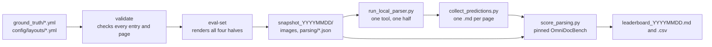

# Synthetic Document Parsing Benchmark

## Abstract

| | |
|---|---|
| **Category** | Synthetic document parsing benchmark |
| **Objective** | Score document parsers on synthetic Australian business documents (bank statements, receipts, tax invoices) whose ground truth is exact, because it is recorded as each page is drawn. Tested: MinerU VLM, MinerU pipeline, Docling, Marker ([the tools](#the-tools-tested)), and on native PDFs a no-model text-layer baseline ([stage two](#native-pdfs-stage-2)) |
| **Approach** | Ground truth is written by the code that draws each page, so it is exact without annotation: no GPU pre-annotation or expert correction is needed, and every printed line is checked to belong to a block ([how](#how-the-ground-truth-is-made)). Stage two typesets the same cases into native PDFs and scores the parsers on them. Limits: three single-page document types with fairly sparse pages; multi-page documents come next |
| **Details** | [Results](#results), [what is measured](#what-it-measures), [the pages](#the-pages), [the runbook](docs/parsing_benchmark_runbook.md) |
| **Summary** | On images (stage one, 14 October 2026), MinerU VLM is the best overall: first on tables and reading order on every clean half, and on text on plain pages, though Docling reads text slightly better on cluttered pages. On photographed receipts no tool reads tables well (TEDS below 0.12). On native PDFs (stage two, 16 October 2026), on these synthetic documents, the text layer alone, with no model, reads text far better than any parser (text edit distance 0.009 on plain pages, 0.051 on cluttered) but gives no table structure (TEDS 0); for tables MinerU VLM is again best (TEDS 0.598 and 0.492), so, on these documents, a native PDF is best routed to the text layer for text and reading order and to a table model for tables. Run locally on an Apple M1 Pro laptop (16 GB), with no GPU instance needed, over 660 pages in stage one (images) and 330 pages in stage two (native PDFs: 165 documents, plain and with distractors), scored with the OmniDocBench evaluator (text edit distance, table TEDS, reading-order edit distance) |

## Overview

A benchmark for document parsers such as MinerU, Docling and Marker: how well does each one read a page
of a business document into structured markdown (its text, its tables and its reading order)? The pages
are synthetic Australian bank statements, receipts and tax invoices, and their ground truth is not
annotated after the fact. It is recorded by the code that draws each page, at the moment it draws it, so
every block, its text, its category, its place in the reading order and every table cell is exact by
construction. Scoring uses the published OmniDocBench evaluator, pinned to one commit and unmodified;
this repository writes ground truth in OmniDocBench's format and does not write a scorer.

---

## The tools tested

Four tools, one of them in two forms, and a no-model baseline for native PDFs. Both MinerU entries are
the same release, MinerU 3.4.5, run with its two different back-ends: they share the package and its
output format, but read a page in entirely different ways.

| Name used here | What it is | How it reads a page | Weights | Time per page |
|---|---|---|---|---|
| MinerU VLM | MinerU 3.4.5, back-end `vlm-engine` | One vision-language model (MinerU 2.5 Pro, 1.2 billion parameters) looks at the whole page and writes the markdown | Apache-2.0 | 25 to 35 s |
| MinerU pipeline | MinerU 3.4.5, back-end `pipeline` | A chain of small specialised models: layout detection, OCR (PaddleOCR), table recognition, reading order | AGPL-3.0 | 3 to 9 s |
| Docling | Docling 2.120.2, standard pipeline | A layout model, a table model (TableFormer) and OCR (RapidOCR) | Apache-2.0, CDLA-Permissive-2.0 (OCR weights unconfirmed) | 5 to 12 s |
| Marker | Marker 2.0.0 | Datalab's layout and OCR models | Modified AI Pubs Open RAIL-M | 49 to 89 s |
| Text layer (baseline) | `pypdfium2` 5.13.0, no model | Reads the lines already in a native PDF's text layer, one paragraph per line; it cannot read an image | None: no model | under 0.01 s |

All four parsers ran unmodified on the same Apple M1 Pro laptop. The config names in the runbook and the
leaderboard files are `mineru_vlm`, `mineru_pipeline`, `docling`, `marker` and `text_layer`. The text
layer is run on native PDFs only. Marker is not run on PDFs: it was scored on images in stage one only,
and those results stand.

## What it measures

| Metric | What it scores | Better |
|---|---|---|
| Text edit distance | The page's text, block by block, as normalised edit distance | Lower (0 is perfect) |
| Table TEDS | Each table's structure and cell text, as tree-edit-distance similarity | Higher (1 is perfect) |
| Table TEDS, structure only | The same, ignoring cell text | Higher |
| Table edit distance | Each table's html, as normalised edit distance | Lower |
| Reading-order edit distance | The order the blocks are read in | Lower |

OmniDocBench's headline Overall score also needs formula scores, which arrive with documents that carry
formulas (stage three, below), so the leaderboard leaves Overall blank rather than average the other
components in its place. The leaderboard breaks every score down by document type, degradation tier and
layout.

**Known quirks of the pinned evaluator.** They are recorded, not patched, so scores stay comparable with
published OmniDocBench results:

- The first table matched on a page drops out of the predicted reading order, which costs every tool
  about one edit on each page with a table.
- A markdown pipe table loses every cell that holds a colon. Html tables (both MinerU back-ends) are
  immune; Docling and Marker write markdown.
- Table edit distance compares html strings, and a markdown table converts to html with attributes an
  html table lacks. Compare it only between tools with the same output form; TEDS is unaffected.
- An invoice's remittance slip repeats the invoice number and amount due from the body. The evaluator
  merges the two copies into one ground-truth entry, so a tool that transcribes the line once is charged
  0.5 for the copy it left out.

[`docs/parsing_benchmark_runbook.md`](docs/parsing_benchmark_runbook.md) has the evidence for each.

## The pages

One export, the evaluation snapshot, holds 660 pages in four sets ('halves'). The three clean halves
hold the same 165 documents, with the same file names and the same ground truth, so comparing two of
them isolates one effect.

| Half | Pages | What is on them |
|---|---|---|
| `plain` | 165 | The documents as laid out |
| `distractor` | 165 | The same pages with values a reader must not confuse with the real ones: a store number, an ACN beside the ABN, a due date beside the invoice date |
| `labelled_varied` | 165 | The distractor pages with the labels on the ABN, GST and total varied: the usual wording, another wording, or no label |
| `degraded` | 165 | The 55 distractor receipts, each photographed at three severity tiers (light, moderate, heavy) |

`plain` against `distractor` measures what clutter costs; `distractor` against `labelled_varied`
measures whether a tool reads values or leans on familiar labels; the degraded receipts against their
distractor originals measure what a phone photograph costs.

| Document type | Documents | Layouts |
|---|---|---|
| Bank statement | 55 | 8 |
| Receipt | 55 | 6 |
| Tax invoice | 55 | 8 |

File names are generic (`CASE001_receipt.png`), and the published pages carry opaque layout keys
(`receipt_layout_3`), so a tool cannot infer the template from the name.

### Two ground truths: which one the parsers are scored against

The snapshot carries two ground truths for the same pages, for two different benchmarks. Mixing them up
is the easiest mistake to make here.

| File | For | What it holds |
|---|---|---|
| `parsing/<half>.json` | **This benchmark.** Every parser score is computed against it | A full transcription of each page in OmniDocBench's format: every block of text (headings, names, addresses, labels such as 'Bill To:' and 'Subtotal:', values), its category, its place in the reading order and its position, and every table as html, cell by cell |
| `<half>/ground_truth.csv` and `.jsonl` | The [extraction benchmark](#the-extraction-benchmark) | One row per page: the file name and 17 field values (ABN, dates, GST, total, line items and so on) |

The pages are drawn from those 17 field values, plus the layout's own fixed text (headings and labels)
and, on the distractor and later halves, the distractors. Everything drawn, whatever its source, is
recorded in the parsing ground truth, and `validate` refuses any page where a line of ink belongs to no
block. On the plain half a page averages about 7 blocks and 150 table cells (bank statement), 12 blocks
and 14 cells (invoice) or 24 blocks and 7 cells (receipt).

## Results

Scored 14 October 2026 on an Apple M1 Pro (16 GB), every tool on its Metal (`mps`) device, against
snapshot `snapshot_20261014` (the degraded half against `snapshot_20261013`, the snapshot its runs were
made on, whose degraded ground truth is identical).

**Text edit distance** (lower is better)

| Tool | plain | distractor | labelled_varied | degraded |
|---|---|---|---|---|
| MinerU VLM (`vlm-engine`) | **0.241** | 0.269 | 0.261 | 0.203 |
| Docling 2.120.2 | 0.290 | **0.255** | **0.251** | 0.249 |
| Marker 2.0.0 | 0.360 | 0.336 | 0.329 | **0.132** |
| MinerU pipeline (`pipeline`) | 0.637 | 0.539 | 0.536 | 0.546 |

**Table TEDS** (higher is better)

| Tool | plain | distractor | labelled_varied | degraded |
|---|---|---|---|---|
| MinerU VLM (`vlm-engine`) | **0.601** | **0.516** | **0.547** | 0.085 |
| Docling 2.120.2 | 0.425 | 0.451 | 0.460 | 0.026 |
| Marker 2.0.0 | 0.427 | 0.491 | 0.495 | 0.090 |
| MinerU pipeline (`pipeline`) | 0.458 | 0.397 | 0.381 | **0.115** |

**Reading-order edit distance** (lower is better)

| Tool | plain | distractor | labelled_varied | degraded |
|---|---|---|---|---|
| MinerU VLM (`vlm-engine`) | **0.284** | **0.346** | **0.342** | 0.167 |
| Docling 2.120.2 | 0.297 | 0.368 | 0.371 | 0.351 |
| Marker 2.0.0 | 0.459 | 0.451 | 0.443 | **0.143** |
| MinerU pipeline (`pipeline`) | 0.634 | 0.596 | 0.595 | 0.586 |

MinerU VLM leads on clean pages. On photographed receipts no tool reads tables well (TEDS
below 0.12 for all four). Marker's strong degraded text score reflects how it reads a receipt photograph
(as plain text rather than a table), not better recognition; the runbook explains this and how each tool
behaves. Time per page runs from 3 to 9 seconds (MinerU pipeline) to 49 to 89 seconds (Marker).

The full leaderboard (structure-only TEDS, table edit distance, every breakdown, each run's versions
and timings) is written to `../evaluation_data/leaderboard_<YYYYMMDD>.md` and `.csv`, and
[`docs/parsing_benchmark_runbook.md`](docs/parsing_benchmark_runbook.md#first-leaderboard-14-october-2026)
discusses it.

## Native PDFs (stage 2)

Stage two typesets the same cases as stage one's `plain` and `distractor` halves into native PDFs with a
text layer, as accounting and banking software makes them, and ships each page as a PDF paired with its
PNG. The two sets are `typeset_plain` and `typeset_distractor` (165 pages each); in this section
'cluttered' means the distractor set. Scored 16 October 2026 on the same laptop, against snapshot
`snapshot_20261016`. Runs made: MinerU pipeline, MinerU VLM and Docling on the PDFs of both sets; the
no-model text-layer baseline on both; and one control, Docling on the typeset PNG of `typeset_plain`.
Marker was dropped from stage two (the project owner's decision): it was scored on images in stage one only,
and its results stand.

**Scores on native PDFs**

| Tool | Text edit, plain | Text edit, cluttered | TEDS, plain | TEDS, cluttered | Reading order, plain | Reading order, cluttered |
|---|---|---|---|---|---|---|
| Text layer (no model) | **0.009** | **0.051** | 0.000 | 0.000 | **0.105** | **0.099** |
| MinerU VLM (`vlm-engine`) | 0.253 | 0.282 | **0.598** | **0.492** | 0.315 | 0.365 |
| Docling 2.120.2 | 0.333 | 0.262 | 0.492 | 0.461 | 0.353 | 0.376 |
| MinerU pipeline (`pipeline`) | 0.619 | 0.528 | 0.471 | 0.428 | 0.635 | 0.570 |

Edit distances: lower is better. TEDS: higher is better. The text layer has no table structure, so its
TEDS is 0.

- **Text and reading order.** With no model, the text layer reads text far better than every parser (0.009
  and 0.051 against 0.253 at best on plain pages and 0.262 on cluttered ones) and keeps the page's reading
  order far better (0.105 and 0.099 against 0.315 and 0.365 at best). It gives no table structure.
- **Tables.** MinerU VLM is best (TEDS 0.598 plain, 0.492 cluttered), then Docling (0.492, 0.461), then
  MinerU pipeline (0.471, 0.428).
- **MinerU pipeline still trails far behind the text layer.** On plain PDFs its text edit distance is
  0.619 against the text layer's 0.009, although it reads the same text layer, which suggests its layout
  step, not character reading, limits it.
- **Routing.** On these synthetic documents, a native PDF is best read for text and reading order from its
  text layer, with a table model used where table structure matters. This is a finding about these
  documents, not a claim about all PDFs.

**Table gain over the stage one image score** (TEDS, PDF score minus image score: positive means the PDF
helped)

| Tool | plain | cluttered |
|---|---|---|
| Docling 2.120.2 | +0.068 | +0.011 |
| MinerU pipeline (`pipeline`) | +0.012 | +0.030 |
| MinerU VLM (`vlm-engine`) | -0.003 | -0.024 |

Each gain is measured against the tool's stage one image score for the same half: `typeset_plain` against
`plain`, `typeset_distractor` against `distractor`. The typeset pages are drawn afresh from the same
cases, so this is not a same-render comparison. MinerU VLM reads a PDF by rendering it and does not use
the text layer, which fits its gain of about nothing. The text layer has no stage one image score, so it
shows no gain. The leaderboard also holds the gains of structure-only TEDS and table edit distance.

**The control, and why there is no text gain.** To see how far the typeset render alone moves a score,
Docling was run on the typeset PNG of `typeset_plain` and compared with its stage one score on `plain`.
Its text edit distance differs by 0.028 (0.318 against 0.290), beyond the 0.02 threshold; its table TEDS
differs by 0.019 (0.443 against 0.425), within it. The render alone therefore moves text scores slightly,
so a text gain would mix the change of render with the change of input. By the project owner's choice,
text gains and reading-order gains are not reported; table gains are, each labelled as measured against
the stage one image score. The leaderboard prints every gain, each with the control's warning.

## Tools and licences

Each tool was run unmodified, from its published release and weights, for research. No tool's authors
endorse this benchmark or its results.

| Tool | Project | Code licence | Model weights licence |
|---|---|---|---|
| MinerU | [opendatalab/MinerU](https://github.com/opendatalab/MinerU) | [MinerU Open Source License](https://github.com/opendatalab/MinerU/blob/master/LICENSE.md) (Apache-2.0 with additional terms) | [MinerU2.5-Pro](https://huggingface.co/opendatalab/MinerU2.5-Pro-2605-1.2B): Apache-2.0; [PDF-Extract-Kit-1.0](https://huggingface.co/opendatalab/PDF-Extract-Kit-1.0): [AGPL-3.0](https://github.com/opendatalab/PDF-Extract-Kit) |
| Docling | [docling-project/docling](https://github.com/docling-project/docling) | [MIT](https://github.com/docling-project/docling/blob/main/LICENSE) | [Layout](https://huggingface.co/docling-project/docling-layout-heron): Apache-2.0; [TableFormer](https://huggingface.co/docling-project/docling-models): Apache-2.0 and CDLA-Permissive-2.0; OCR: see [RapidOCR](https://github.com/RapidAI/RapidOCR) |
| Marker | [datalab-to/marker](https://github.com/datalab-to/marker), by Datalab | [Apache-2.0](https://github.com/datalab-to/marker/blob/master/LICENSE) | [Modified AI Pubs Open RAIL-M](https://github.com/datalab-to/surya/blob/master/MODEL_LICENSE) |

Marker's scores were produced with Datalab's models
[`datalab-to/surya-ocr-2-gguf`](https://huggingface.co/datalab-to/surya-ocr-2-gguf) and
[`datalab-to/surya_layout2`](https://huggingface.co/datalab-to/surya_layout2), unchanged, and are credited
to Datalab under that model licence, whose full text is at the link above. The models' raw output is not
published here; the scores are computed from it by the OmniDocBench evaluator.

## How it fits together



Everything the pipeline writes goes to `../evaluation_data/`, beside the repository, never inside it.

## Quick start

The generator runs from the conda env in `environment.yml`; the evaluator and each parser run from their
own envs under `envs/`, so none of their packages enter it.

```bash
# The generator's env, once per machine (the post-install step is required: it installs augraphy
# without displacing the headless OpenCV build)
conda env create -n synthetic -f environment.yml
CONDA_ENV=synthetic bash scripts/post_install.sh

# Output goes beside the repository, which must exist first
mkdir ../evaluation_data

# Check every ground-truth entry and every page's parsing ground truth, failing fast on any problem
conda run -n synthetic python -m generators.pipeline validate

# Export the snapshot: four halves of 165 images, the parsing ground truth in parsing/, a manifest
conda run -n synthetic python -m generators.pipeline eval-set
python ../evaluation_data/snapshot_<YYYYMMDD>/tools/verify_snapshot.py

# The evaluator, once per machine: clone OmniDocBench at the pinned commit and build its env
conda run -n synthetic python scripts/omnidocbench_eval.py checkout
conda env create -n omnidocbench -f envs/omnidocbench.yml
conda run -n omnidocbench pip install -e ../evaluation_data/tools/OmniDocBench

# The parsers' envs, once per machine (model weights: see the runbook)
conda env create -f envs/mineru.yml && conda env create -f envs/docling.yml && conda env create -f envs/marker.yml

# Run one tool over one half, collect its markdown, then score everything collected
conda run -n synthetic python scripts/run_local_parser.py \
    --tool docling --snapshot ../evaluation_data/snapshot_<YYYYMMDD> --half plain --input png
conda run -n synthetic python scripts/collect_predictions.py --tool docling --half plain
conda run -n synthetic python scripts/score_parsing.py --snapshot ../evaluation_data/snapshot_<YYYYMMDD>
```

The tools are `mineru_pipeline`, `mineru_vlm`, `docling` and `marker`; the halves are `plain`,
`distractor`, `labelled_varied` and `degraded`. All sixteen runs take about 17 hours on the machine
above, most of it Marker and MinerU VLM; run one tool at a time, since each uses the GPU.
[`docs/parsing_benchmark_runbook.md`](docs/parsing_benchmark_runbook.md) covers every step in detail:
model weights, where each tool writes, scoring a half against an earlier snapshot, and the leaderboard's
layout.

## How the ground truth is made

Each layout is a declarative YAML tree under `config/layouts/`, and the renderer records every line of
ink it draws together with the block and table cell that drew it. From those records `eval-set` writes
one OmniDocBench page per image: blocks with their text, category, reading order and polygon, and tables
as html. Four layout keys shape the result where the drawing alone cannot:

| Key | On | Effect |
|---|---|---|
| `parse_block` | A container | `true` makes the container and everything in it one block |
| `parse_category` | Any block | Sets the OmniDocBench category, such as `title` or `text_block` |
| `parse_order` | Any block | Ranks the block in reading order |
| `parse_join` | A table | Writes the table's rows into the nearest earlier table, such as a statement's totals |

`validate` (and `eval-set` again) checks six invariants on every page and refuses with a diagnostic
naming the layout, the key and the fix: every line of ink belongs to exactly one block; a block's text is
its ink in draw order, and a table's cells hold exactly the ink drawn inside them; every scored value
appears verbatim in some block; every polygon lies within its page; every category is in OmniDocBench's
vocabulary; and no block in a category the evaluator ignores (page headers and footers) comes close
enough to a scored block's text to be matched in its place. Degraded receipts carry their boxes through
the camera warp; blocks the photograph crops are clipped and marked to be ignored.

[`docs/parsing_benchmark_design.md`](docs/parsing_benchmark_design.md) is the full specification.

## Publishing

The snapshot directory is the only thing that is uploaded. Its file names and every non-image file are
scanned for terms that would reveal how it was made, and one hit refuses the export; what produced it
(commit, input hashes, any uncommitted changes) is kept beside it in `snapshot_<YYYYMMDD>.provenance/`,
which is never uploaded. The runbook's
[licence section](docs/parsing_benchmark_runbook.md#licences-of-the-tools-scored) sets out the terms
under which each tool's scores are published.

## Programme

| Stage | Pages | Status |
|---|---|---|
| One | The PIL business documents above, 660 pages | Complete: ground truth, invariants, first leaderboard |
| Two | Stage one's cases typeset with Typst, as native PDFs paired with images | Complete: [results](#native-pdfs-stage-2), [outcome](docs/parsing_benchmark_stage2_design.md#10-outcome) |
| Three | New genres, one per stage, including formulas | After stage two; formulas enable the Overall score |

[`docs/parsing_benchmark_design.md`](docs/parsing_benchmark_design.md) outlines stages two and three, and
[`docs/parsing_benchmark_stage1_plan.md`](docs/parsing_benchmark_stage1_plan.md) records how stage one was
built and what stage two should know.

## The extraction benchmark

This repository is a clone, with shared history, of a synthetic business-document generator built for an
extraction benchmark: a vision-language model reads a page and returns field values such as the ABN, the
GST amount and the total, scored by F1 per field. That benchmark is untouched here. The same snapshot
carries its ground truth (`ground_truth.csv` and `.jsonl` in each half, field bounding boxes in
`geometry/`), and its scoring notebook ships in the snapshot's `tools/`. The original repository is the
`upstream` remote, fetch only; its later fixes come in by cherry-pick.

## Reference

| Document | Covers |
|---|---|
| [`docs/generator_reference.md`](docs/generator_reference.md) | Every generator command, the snapshot's layout and manifest, distractors, label variation, receipt degradation and rectification, the ground-truth YAML, the export schemas and the file structure |
| [`docs/parsing_benchmark_runbook.md`](docs/parsing_benchmark_runbook.md) | Building the evaluator and parser envs, running, collecting and scoring, the first leaderboard, licences |
| [`docs/parsing_benchmark_design.md`](docs/parsing_benchmark_design.md) | The parsing benchmark's specification |
| [`docs/generator_capability_overview.md`](docs/generator_capability_overview.md) | What the generator can and cannot do, and what on a page is real |
| [`docs/remote_extraction_runbook.md`](docs/remote_extraction_runbook.md) | Running the extraction benchmark on a remote GPU host |
