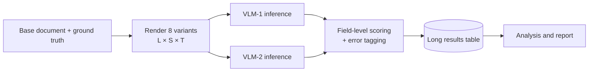

# Comparing Two VLMs on Document IE: Factorial Benchmark Design

## 1. Goal and scenario

Two Vision Language Models (VLMs), given the same prompt, are compared on Information Extraction (IE)
quality over invoices, receipts and bank statements. Each **base document** has one IE ground truth.
Its rendered variants differ only in **missing field labels** and **distraction** (an irrelevant
supplier block, a taxpayer annotation); content and ground truth stay the same.

The questions to answer:

1. Which model extracts more accurately overall?
2. **Robustness:** does one model degrade more than the other when labels are missing or distractors
   are present?
3. Does the ranking change by document type?

## 2. Design: a paired, fully crossed factorial

Every base document is rendered under every condition, and **both models run on every render**. Each
model is compared with the other on the same documents, so content difficulty cancels.

| Factor | Levels | Varies within a base document? |
|---|---|---|
| **M**: model | VLM-1, VLM-2 | Yes |
| **D**: document type | invoice, receipt, bank statement | **No** |
| **L**: field labels | present, missing | Yes |
| **S**: irrelevant supplier block | absent, present | Yes |
| **T**: taxpayer annotation | absent, present | Yes |

- Distraction is split into **one binary factor per distractor type**, so the results show which
  distractor does harm and whether the two compound (S×T). A graded 'extent' can be added later.
- 2 × 3 × 2 × 2 × 2 = 48 cells. Inference is the only cost, so run the **full factorial**; a
  fractional design would alias effects for no saving worth having.
- Each base document yields 8 renders × 2 models = 16 scored outputs.
- **The unit of replication is the base document**, not the render. The 8 renders are repeated
  measurements of one document, so they are not independent samples.
- Factors, levels and run settings live in a YAML config, validated at startup; the code must not
  carry default levels.



## 3. Implementation steps

**3.1 Generation.** Render each base document's 8 variants from one ground-truth record. The
ground-truth sidecar must record, per variant, the factor levels **and every distractor value
injected** (for example the irrelevant supplier's name and ABN). The generator must assert that no
distractor value equals a true field value, otherwise a distractor hit cannot be told apart from a
correct extraction. With a label missing, the value must still be present and unambiguous on the
page; spot-check a sample by eye before the full run.

**3.2 Inference.** Use the same prompt, greedy decoding (temperature 0) and the same image resolution
for both models. Log the model revision, seed and settings with every output. If sampling is ever
used, repeat runs and treat the run as an extra random effect.

**3.3 Scoring.** Score **per field**, after the same normalisation for both models (dates, amounts,
ABN spacing, case). Assign each field one outcome:

| Outcome | Meaning |
|---|---|
| `correct` | Prediction matches ground truth |
| `omitted` | Field present in ground truth, nothing extracted |
| `distractor` | Prediction matches an injected distractor value |
| `wrong` | Any other mismatch |
| `spurious` | Value extracted for a field absent from ground truth |

The `distractor` tag matters most: distractors mainly cause substitutions, which a recall-only
metric cannot see. The per-model **fooled rate** (`distractor` / fields at risk) is a headline
result.

**3.4 Results table (long format, one row per model × render × field).**

`base_doc_id, doc_type, variant_id, labels, supplier, taxpayer, model, model_revision, field,
gt_value, pred_value, outcome, correct`

## 4. Analysis

**Primary: within each document type.** Field sets differ by type, so comparisons across types mix
layout difficulty with field difficulty. Fit one logistic model per type with sum (effect) coding,
field fixed effects and standard errors clustered on base document (statsmodels, BSD licence):

```python
import pandas as pd
import statsmodels.api as sm
import statsmodels.formula.api as smf
from statsmodels.genmod.generalized_linear_model import GLMResults


def fit_within_type(df: pd.DataFrame, doc_type: str) -> GLMResults:
    """Fit the factorial logistic model for one document type, clustered on base document."""
    sub = df[df["doc_type"] == doc_type]
    formula = (
        "correct ~ C(model, Sum) * C(labels, Sum) * C(supplier, Sum) * C(taxpayer, Sum) + C(field)"
    )
    groups = pd.factorize(sub["base_doc_id"])[0]
    return smf.glm(formula, data=sub, family=sm.families.Binomial()).fit(
        cov_type="cluster", cov_kwds={"groups": groups}
    )
```

If a field is always correct (perfect separation), drop `C(field)` for that fit and rely on the
bootstrap below. The full mixed model, `correct ~ M*D*L*S*T + (1 | base_doc) + (1 | field)`, can be
fitted with R's `lme4` (GPL: fine for internal analysis, not as a shipped dependency).

**Secondary: pooled across types** for M×D, with clustering on base document.

**Effect sizes.** Report accuracy differences (VLM-1 minus VLM-2) per cell with 95% intervals from a
**cluster bootstrap that resamples base documents**, not fields or renders. Log-odds coefficients
are for testing; percentage-point differences are what readers need.

**Pre-registered confirmatory effects** (Holm-corrected; everything else is exploratory):

1. **M**: overall model difference.
2. **M×L, M×S, M×T**: differential robustness.
3. **M×D**: ranking stability across document types.

Report a material interaction as simple effects (for example 'VLM-1 minus VLM-2 on receipts with
labels missing'), not as the main effect alone.

## 5. Sample size

Power for the model comparison comes from **discordant fields** (one model right, the other wrong).

1. Run a pilot of about 30 base documents per type.
2. Estimate per-cell accuracy, discordance rate and the between-document variance.
3. Simulate from those estimates to find the number of base documents needed to detect the smallest
   M×condition interaction that would change the choice of model. Interactions need roughly 4× the
   sample of a main effect of the same size.

## 6. Caveats to state in the report

- **'Model' means model plus this prompt.** A shared prompt may suit one model's training style
  better; prompt can be added as a factor later.
- **Synthetic distractors are a proxy.** The results measure robustness to these injected
  distractors; transfer to real-world clutter is a separate claim.
- **Document-type effects are descriptive**, since type is confounded with field set and layout.
