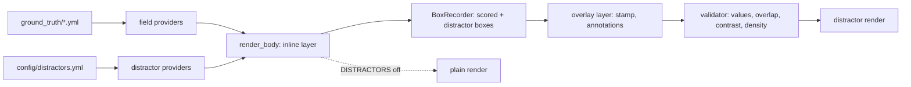

# Distractor Overhaul: Design

Status: design agreed 6 October 2026, awaiting written review.
Scope: sub-project A (unscored distractors). Sub-project B (changes to what scored fields mean) gets its own design once A has shipped.

## 1. Why

Two vision-language models (InternVL3.5-8B and Gemma-4-31B, 4-bit QAT) score unrealistically high on the corpus's 17 extraction fields (14 for receipts and invoices, 3 more for bank statements). The cause is visible on the page: almost everything printed is a scored field.

- A photographed post-office receipt used as a reference carries a logo, a second identifier beside the ABN, a tracking number printed twice, a long barcode number, a QR code and several paragraphs of instructions. Our receipts carry none of that.
- Our invoices occupy roughly the top 30% of an A4 page, and nearly every line is scored. Real business invoices are dominated by self-promotion and legal text, which is why our invoices currently score *above* our receipts while in practice they are harder.
- Bank statements that taxpayers hand over are often annotated: highlighter on claimed work-related expenses, ticks, margin notes and handwritten sums. Ours are pristine.
- On real PROD images, InternVL3.5 extracts ABN, GST and total reliably when the document names them, and much less reliably when the label is absent. Every layout in the corpus prints `ABN:`, `GST` and `TOTAL` explicitly, so label presence, a known difficulty factor, is never varied.

## 2. Goals

- Add realistic distractors (barcodes, QR codes, PAID stamps, taxpayer annotations and lookalike fields) to receipts, invoices and bank statements.
- Render every case with and without distractors from the same ground truth, so the score drop can be measured.
- Render a third version with variant or absent labels on ABN, GST and total, so the effect of labels can be measured separately.
- Publish dated, standalone snapshots to S3, each documented with a README and a checksummed manifest.

### Non-goals

- No change to what any scored field means (that is sub-project B: multi-line line items, GST as a footnote, rounding lines).
- No numeric target for the score drop. Tuning the corpus towards a desired result would make the measurement circular.
- No generation on PROD. The generator runs locally and in the development sandbox only; PROD and other users receive snapshots.

## 3. Decisions

| Question | Decision |
| --- | --- |
| Ground-truth contract | Unchanged in A. Distractors are unscored. |
| Control set | Paired: every case renders plain and with distractors from identical ground truth. |
| Label presence | A third render, `labelled_varied`: distractors plus seeded variant or absent labels on BUSINESS_ABN, GST_AMOUNT and TOTAL_AMOUNT. Plain and distractor renders keep today's labels. |
| Hardness | Near-misses included: labelled, same-type lookalikes of scored fields, alongside generic clutter. |
| PAID stamp overlap | May cover labels and unscored text; never a scored field's box. |
| Bank annotation overlap | Translucent highlighter may cover scored rows (contrast-checked); opaque ink never crosses a scored box. |
| Annotated bank rows | Rows linked in `ground_truth/transaction_links.yml`, plus 1 to 3 seeded extra debits. |
| Invoice layouts | Keep the existing 4; add 4 industry layouts (trade, professional letterhead, wholesale/supplier, subscription). |
| Degraded half | Degrade the distractor receipts, not the plain ones. |
| Dependencies | `segno` (QR) and `python-barcode` (Code 128, EAN-13) added to `environment.yml`; vendored OFL handwriting fonts. |

## 4. Architecture

Two layers behind one switch.



- **Inline layer.** Distractor blocks live in each layout's own DSL `body:`, in the place they would occupy on a real document, gated by `when:` on provider-emitted flags and on the `DISTRACTORS` render flag.
- **Overlay layer.** A separate `overlay:` list per layout, run after `render_body` on the finished page, with every scored field's box already known.
- **Plain render.** With `DISTRACTORS` off the overlay is skipped and every inline distractor block is suppressed, so the plain render of an existing layout is pixel-identical to today's, apart from the two invoice bug fixes in section 10.
- **Label-varied render.** A second flag, `LABEL_VARIATION`, layered on a distractor render, swaps the labels of three scored fields (section 6). Three flag settings give the three clean halves: neither, `DISTRACTORS`, and both.

## 5. Distractor catalogue

Every item is one of three kinds:

- `clutter`: unscored noise that must contain no scored value;
- `near_miss`: a labelled lookalike of one scored field (`target:`), which must differ from it;
- `repeat`: a second printing of a scored value under a same-meaning label (`field:`), which must equal it exactly.

Each layout declares the items it can carry; the provider selects a seeded subset per case, so two cases on one layout do not carry identical clutter.

### Receipts (inline only)

| Region | Items | Near-miss target |
| --- | --- | --- |
| Header | Logo; store or branch number; merchant ID or ACN; phone; website | BUSINESS_ABN |
| POS line | Time with seconds; operator, till and receipt number; long transaction ID | |
| Body | Loyalty member number and points balance; 'You saved $x' lines; 'Items: n' | LINE_ITEM_TOTAL_PRICES, TOTAL_AMOUNT |
| Footer | Barcode of the transaction ID; QR survey code with survey code; 'Returns by DD/MM/YYYY'; returns policy | INVOICE_DATE |

### Invoices (inline, plus PAID stamp overlay)

| Region | Items | Near-miss target |
| --- | --- | --- |
| Letterhead | Logo; tagline; contact block (phone, mobile, 1300 number, email, website, social handles) | |
| Identifiers | Invoice, PO and customer numbers; ACN; trade licence; accreditation and membership lines | BUSINESS_ABN |
| Parties | 'Ship To' or site address beside 'Bill To'; remittance PO Box; head office and branch addresses | PAYER_ADDRESS, BUSINESS_ADDRESS |
| Dates | Due date; supply date | INVOICE_DATE |
| Services | 'Our services' list; promotional panel with a price | LINE_ITEM_DESCRIPTIONS, LINE_ITEM_PRICES |
| Line table | Item code column; per-line GST column; discount line | LINE_ITEM_PRICES |
| Notes | Job notes or site reference; contact person and direct line | PAYER_NAME |
| Totals | 'Amount Paid'; 'Balance Due $0.00' on paid invoices; 'Previous balance' | TOTAL_AMOUNT |
| Payment | BSB and account; BPAY biller code and reference; PayID; card surcharge note | |
| Terms | Payment terms; late fee ('2% per month', '$35 admin fee'); warranty; retention of title | TOTAL_AMOUNT, INVOICE_DATE |
| Remittance slip | Tear-off slip with barcode, repeating invoice number and total (`repeat`) | |
| Footer | Repeated contact band; 'Thank you for your business'; page 'n of n' | |
| Overlay | PAID stamp, optionally dated with the linked bank transaction's date | INVOICE_DATE |

### Bank statements

| Layer | Items | Near-miss target |
| --- | --- | --- |
| Inline | 'Statement issued' date; mailing barcode in the address block; promotional message box | STATEMENT_DATE_RANGE |
| Overlay | Highlighter on claimed rows; pen circles, underlines and ticks; margin notes ('WRE', 'D5 car', '50% work'); handwritten running total of the claimed rows | TRANSACTION_AMOUNTS_PAID |

The handwritten total is the correct sum of exactly the annotated rows, as a taxpayer would write it, which makes it a near-miss for every individual amount.

*Revision, 7 October 2026.* The invoice line-table items (an item code column, a per-line GST column, a discount line) are deferred to a later pass. A distractor provider emits single values, one per key, and a table distractor needs a value per row, aligned with the scored rows; that needs a row-level provider the catalogue does not have. Stage 4 therefore ships no table-level clutter: `tax_invoice_wholesale` prints its item code inside the scored description (the catalogue line carries it), and no layout prints per-line GST. The previous balance, listed under Totals above, prints in an account summary panel of its own, not in the totals column: previous balance, the payment that cleared it, this invoice and the amount due, so the summary adds up.

### New invoice layouts

Four industry layouts join the existing four, each designed around the catalogue above rather than retrofitted:

| Layout | Character |
| --- | --- |
| `tax_invoice_trade` | Tradie letterhead, licence number, job and site notes, labour and materials lines |
| `tax_invoice_professional` | Formal letterhead, matter reference, long terms, remittance advice |
| `tax_invoice_wholesale` | Item codes, per-line GST, ship-to address, delivery docket number |
| `tax_invoice_subscription` | Account number, billing period, plan lines, direct-debit notice |

The seed script redistributes invoice cases across all eight layouts. Scored values are unchanged; the `layout:` key of some invoice entries changes, so this is a reseed and content-pinned baselines must be re-captured.

## 6. Label variation (third render)

Scored values are untouched; only the label printed beside them changes. Each case draws one style per field from `sha256("{case_id}:labels:{doc_type}")`, with style weights and variant wording in `config/distractors.yml`.

| Field | `labelled` (today) | `variant` | `unlabelled` |
| --- | --- | --- | --- |
| BUSINESS_ABN | `ABN: 12 345 678 901` | `A.B.N.`, `ABN No.`, `Australian Business Number` | bare digits under the trading name |
| GST_AMOUNT | `GST  58.61` | `Tax`, `GST 10%`, `Includes GST of $58.61` | bare figure in the totals column |
| TOTAL_AMOUNT | `TOTAL  $644.71` | `Amount`, `Total (inc GST)`, `Amount Due` | large bold figure with no label |

(Example values are invented.)

- Layouts bind the label through a `{LABEL_*}` key emitted by a `label_styles` provider, active only when the `LABEL_VARIATION` render flag is on. With it off, the key resolves to today's label, so the plain and distractor renders are unchanged.
- Every value is still printed verbatim, so the ground truth is identical across all three renders.
- The chosen style per field per image is written to a `label_styles.jsonl` sidecar in that half, so scores can be stratified by style. It is metadata, never ground truth.
- **An unlabelled field must remain unambiguous to a careful reader**, which the validator enforces:
  - unlabelled ABN: no other 11-digit number on the page passes the ABN checksum;
  - unlabelled GST: the figure sits in the totals block, above the total, and no other amount there equals total / 11;
  - unlabelled total: it is the last and most prominent amount in the totals block, and no near-miss amount shares its size or weight.

*Revision, 8 October 2026 (Stage 6, as built).* Eight decisions refine this section where it is silent or the layouts disagree with it:

- **Bank statements carry no label sites.** No bank layout prints BUSINESS_ABN, GST_AMOUNT or TOTAL_AMOUNT, so `label_variation.doc_types.bank_statement` is an explicit `[]`, no bank layout declares `label_styles`, and a statement's labelled varied page is byte-identical to its distractor page. The half still holds 165 images under shared filenames, and a bank statement's sidecar row carries `styles: {}`.
- **A label site's wording carries its own punctuation.** A pair draws `label + separator`, so an empty label would still print a lone colon before an unlabelled value. Every label-site pair moves its separator into its labelled wording (`Total:` with `separator: ""`), which draws the same string and so the same pixels; every pool wording carries its own punctuation (`Amount due:`, `Includes GST of`), and an unlabelled site prints the value alone. A text site (`{LABEL_BUSINESS_ABN}{BUSINESS_ABN}`) carries the separating space in its wording (`ABN: `).
- **The totals block is declared, not inferred.** No layout named it, and line spacing cannot find it on a receipt, where every line shares one pitch. A `stack` may carry `region: totals`, drawing exactly what its children would; every layout with a GST or total site has exactly one such region holding both sites. Receipts wrap SUBTOTAL, GST, TOTAL and 'You saved'; invoices wrap the right-hand totals column. The account summary and the remittance slip stay outside it.
- **'The figure sits above the total' stands.** `tax_invoice_gst_inclusive` prints GST after the total, as a component of it, and a bare figure below a bold total reads as a payment or balance line, so that layout never prints its GST unlabelled; with GST below it, its total is not the last amount either, so it never prints the total unlabelled. Style coverage is counted over invoices as a whole.
- **'Shares its size or weight' reads as size and weight, page-wide, plus prominence within the region.** Taken literally, any near-miss at the body size would forbid an unlabelled total on every receipt. The rule is two checks: no distractor amount anywhere on the page is drawn at the total's size and weight together, and within the totals region no other amount is larger, or the same size and bold where the total is not.
- **'Last amount' ignores repeats of the total.** A line printing the total itself ('Amount paid' on a paid invoice, an unpaid invoice's account-summary 'Amount due') gives the right answer whichever line a reader takes, so it counts against neither 'last' nor the size-and-weight twin. Every other amount below the total does: 'Balance due $0.00' and 'You saved' refuse an unlabelled total.
- **A variant collides with any distractor line, not only a near-miss label.** The page's ink does not know an item's kind, and a wording sharing a word with any distractor line invites the same misreading. A variant is refused when its words, case-folded and stripped of punctuation, share a word outside its field's `label_variation.collision.ignore_words` with any distractor text line on the page ('Balance' against 'Balance due', 'Amount due' against the account summary). The ignored words are per field: 'no' and 'number' are ignored beside the ABN only.
- **The sidecar is written per type directory by `generate`.** `generate --distractors --label-variation` writes `<output_dir>/<labelled_varied_output_subdir>/<type>/label_styles.jsonl`, one row per image, so a run of one type never erases another's rows. The snapshot export assembles the half's single `label_styles.jsonl` and its counts.

Beside these, as built: the choices are drawn as orders on the case's label seed, and a refused choice moves the first refused field to its next candidate (`labelled` ends every order and is never refused, so every page renders); every refusal is recorded in the sidecar and counted in the run's summary. A paid invoice withholds 'Balance:' from its total wordings (`label_variation.withheld_by_state`), since over a paid invoice's total it reads as an amount still owing. An 11-digit rival is any window of whole digit groups holding 11 digits, so a stray group before an ABN-shaped number does not hide it, and an unlabelled value whose line moves onto neighbouring ink is refused.

## 7. Primitives and overlay

### Inline primitives

| Primitive | Draws | YAML parameters |
| --- | --- | --- |
| `barcode` | Code 128 or EAN-13 via `python-barcode`, pasted as an image | `content`, `symbology`, `height`, `align`, `human_readable` |
| `qrcode` | QR via `segno` | `content`, `module_px`, `align`, `caption` |
| `logo` | Generated wordmark: a simple shape plus initials or name in the layout font | `style`, `size`, `align` |

Logos are generated, never drawn from stored images, so no real brand mark can appear and the wordmark always agrees with SUPPLIER_NAME. Text distractors use the existing `text`, `pair`, `split` and `panel` primitives.

### Overlay primitives

- `stamp`: a bordered word ('PAID', optionally with a date) drawn on its own RGBA layer with seeded rotation of about ±15°, ink variation and partial opacity, then alpha-composited. Placement takes the first candidate position, in seeded order, whose rotated footprint intersects no scored box.
- `annotation`: highlighter is a translucent band over target rows using a multiply blend, so text stays dark. Ink marks (circles, ticks, underlines) are jittered strokes. Notes and sums use a vendored OFL handwriting font (Caveat, Indie Flower, Kalam or Patrick Hand; see the revision below) under the existing `family:` key, with per-glyph jitter in size, slant and baseline.
- If no legal placement exists the overlay raises a diagnostic naming the layout and the blocking boxes. A mark is never silently skipped.

*Revision, 7 October 2026 (Stage 5, as built).* Six decisions refine the overlay above:

- *The dated PAID stamp is a repeat of INVOICE_DATE.* In the corpus every invoice link's bank date equals its invoice date, so the stamp's date is drawn from `ground_truth/transaction_links.yml` by a `link_date` rule as a `repeat` of INVOICE_DATE, not as its near-miss; the repeat check pins that coherence, and a reseed that pays invoices later fails it.
- *No arrows.* The pen draws ticks, loops and underlines only.
- *Several handwriting faces, one hand per statement.* One face on every annotated statement is itself a learnable pattern, so Caveat, Indie Flower and Patrick Hand are vendored beside Kalam (OFL, static files; Caveat's instances cut from its variable font). Each statement draws one face and weight on a page seed, `sha256("{case_id}:overlay:{doc_type}:hand")`, and one pen colour on another (`...:pen`), so every note, sum and stroke on a page is one person's; glyph jitter varies the strokes within the hand. Lines are sized by x-height, since the faces differ widely at one font size.
- *Overlap is verified on ink pixels.* A loop's bounding box necessarily encloses the amount it rings, so the rule that overlay ink meets no scored box is tested on the drawn stroke: no pixel of an opaque layer lies inside any protected box padded by `overlay.clearance_px`. A bank statement protects every printed line and mark (its scored transaction dates record no box of their own).
- *Contrast is checked on every box a band meets, relative to its starting legibility.* A scored box under a highlighter band must meet `overlay.contrast.min_ratio` after compositing; any other box must too if it met it before (grey reference lines already below it are exempt). The ink is read from the box's ink pixels, not from a percentile of the whole box, so a one-glyph value is not mistaken for blank paper.
- *Density counts what a reader sees as writing.* Stamp text and handwriting record distractor text; ticks, loops and underlines record distractor marks, outside the text denominators; highlighter records nothing, being a tint over text already counted. The overlay records before the renderer hands back its geometry, so `validate` measures the composited page, and it refuses a distractor render that records no distractor ink or mark at all.

Notes and sums sit in lanes: after a row's description ink, in the left or right margin level with the row, or under the paid column below the table. A note tries every row's own lanes, in a seeded order, before the space under the column.

### Geometry

`BoxRecorder` gains a `role` of `scored` or `distractor`. Exports keep emitting scored boxes only; distractor boxes exist so that tests and the validator can prove the overlap rules. A highlighted scored field keeps its box, and its legibility is checked by text-to-background contrast inside the box after compositing.

## 8. Configuration and providers

### `config/distractors.yml`

Every key is required; Python holds no defaults. It declares:

- the catalogue: each item's kind, and its `target:` or `field:`;
- per-type selection counts as `[min, max]`;
- near-miss rules, for example due date offsets of 7, 14 or 30 days and a returns window of 30 days;
- stamp words, colours, rotation range and opacity;
- highlighter colours and opacity, ink colours, stroke jitter, handwriting sizes and glyph jitter;
- the legibility contrast threshold;
- density bounds per document type (section 9).

Each layout lists `distractor_items:`. Validation cross-checks both directions: an item listed but never drawn, or drawn but not listed, fails.

Pool text (promotion wording, policy and terms text, taglines, handwritten notes) goes in `config/data_pools.yml`. Every invented business name, domain and email address is screened against the existing real-name blocklist.

### Providers

`receipt_distractors`, `invoice_distractors` and `bank_distractors` are registered field providers. Each draws from `sha256("{case_id}:distractor:{doc_type}")`, a domain independent of the existing `pos:` digest, so no existing derived value moves. They emit selection flags (`DX_*`) and values. Registration already refuses a provider that emits a scored column, and that guarantee carries over unchanged.

`bank_distractors` selects the annotated rows from the case's links plus seeded extra debits, and computes the handwritten total from exactly those rows.

## 9. Validation

Every check fails fast with the four-part diagnostic: what is wrong, where to fix it (file and dotted key), what valid looks like, and how to recover.

1. **Configuration (startup).** Every key present; every `target:` and `field:` names a real scored field; every layout's `distractor_items:` exists in the catalogue.
2. **Values (after providers).** A near-miss neither equals its target nor contains any scored value; a repeat equals its field exactly; clutter contains no scored value.
3. **Geometry (after overlay).** No stamp or ink box intersects a scored box; every highlighted scored box meets the contrast threshold.
4. **Label unambiguity (`labelled_varied` renders).** The three section 6 rules for unlabelled ABN, GST and total.
5. **Density (distractor and `labelled_varied` renders).** Two metrics from the recorded boxes, bounded per type in YAML:
   - *scored-ink ratio*: scored box area over all text box area (invoices: at most 0.25, as a starting bound);
   - *page fill*: lowest content y over page height (invoices: at least 0.75).

   Plain renders report both metrics without enforcing them, since the control must stay as it is.

   *Revision, 6 October 2026.* Invoice footers and the remittance slip are now drawn upward from the bottom margin (a container option, `anchor: foot`), so every invoice distractor render with a footer ends at the foot of the page and its page fill sits near 0.97 whatever the body's length. Page fill therefore no longer separates a dense invoice from a sparse one on foot-anchored layouts. `page_fill_min` stays a required key, set from measurement, but invoice density is judged by `scored_ink_ratio_max` and by `distractor_share_min` (distractor text over all text ink), whose floor every plain render misses.

   *Revision, 7 October 2026.* Invoices now draw 14 to 22 distractor items, up from 8 to 14, so the median page meets the density target: over the 55 corpus invoices the sampled scored-ink ratio runs from 0.1666 to 0.4188, median 0.2552 (layout medians 0.2203 to 0.3110). A ceiling of 0.25 or 0.30 cannot hold every page: a one-line invoice that happens to draw few items reaches 0.42, and the synthetic six-line entries 0.43. The shipped invoice bounds are therefore set from measurement with at least 10% (relative) headroom over the corpus and the synthetic entries, and are never moved to make a corpus pass: `scored_ink_ratio_max` 0.48 (highest sampled 0.4301; plain renders start at 0.5327), `distractor_share_min` 0.40 (lowest sampled 0.4534) and `page_fill_min` 0.33 (lowest sampled 0.3723). The target, a median near 0.25 to 0.30, is held by a test on the corpus rather than by the per-page ceiling.

Checks run in `validate`, and again on every render in `generate` and `eval-set`.

## 10. Invoice rendering fixes

Two defects found while surveying `tax_invoice_standard` are fixed in this work, each with a regression test:

- the 'Total' label overlaps its amount;
- line-total amounts overrun the right margin.

These are the only permitted pixel changes to the plain control of existing layouts, and the snapshot's change notes record them.

## 11. Snapshot export

```text
snapshot_<YYYYMMDD>/
  README.md
  MANIFEST.json
  tools/      verify_snapshot.py  check_extractions_match_gt.py  score_extractions.ipynb
  plain_<YYYYMMDD>/            165 images, 3 types, ground_truth.csv and .jsonl
  distractor_<YYYYMMDD>/       165 images, same filenames, same ground truth
  labelled_varied_<YYYYMMDD>/  165 images, same filenames, same ground truth, label_styles.jsonl
  degraded_<YYYYMMDD>/         55 distractor receipts x 3 tiers, ground_truth.csv and .jsonl
  geometry/                    scored-field boxes per image, all three clean renders
```

- `synthetic_` becomes `plain_`: every half is synthetic, and the name should say which is the control. The README records the rename.
- `plain_`, `distractor_` and `labelled_varied_` share filenames, so pairing is a direct join. `plain_` against `distractor_` isolates the distractor effect; `distractor_` against `labelled_varied_` isolates the label effect. Degraded filenames keep their tier suffix as today.
- Each snapshot holds 660 images: three clean halves of 165 plus 165 degraded.
- The export refuses a dirty working tree, because a manifest naming a commit that did not produce the files is worse than none.
- **Every snapshot is written under `../evaluation_data/`**, the sibling directory beside the repository that already holds the earlier exports. The location is a required YAML key, `eval_set.output_root: ../evaluation_data` in `config/generation_config.yml`, resolved against the repository root; the `--out` option is removed so the destination cannot drift between runs. A missing key, or a root that does not exist, fails fast with the four-part diagnostic. Nothing a snapshot contains is ever written inside the repository.
- **The working directories move too.** `output_dir` and `derived_dir` become `../evaluation_data/output` and `../evaluation_data/derived`, resolved against the repository root rather than the current working directory. A value that resolves inside the repository, or whose parent does not exist, fails fast with the four-part diagnostic.

### MANIFEST.json

```json
{
  "snapshot_date": "2026-10-06",
  "generator_commit": "<sha>",
  "dirty": false,
  "config_sha256": {"config/distractors.yml": "<sha256>"},
  "counts": {"plain": 165, "distractor": 165, "labelled_varied": 165, "degraded": 165},
  "label_style_counts": {"BUSINESS_ABN": {"labelled": 0, "variant": 0, "unlabelled": 0}},
  "metrics": {"invoice": {"scored_ink_ratio": {}, "page_fill": {}}},
  "files": {"plain_20261006/CASE001_invoice.png": "<sha256>"}
}
```

### README.md

Written for a reader with no repository access, and generated from a template plus the manifest so counts and hashes cannot disagree with the files. Sections:

1. Purpose, and the four halves: what each one varies relative to the next.
2. **The role of MANIFEST.json**:
   - *integrity*: every file's SHA-256 matches and nothing is missing or extra, proving the S3 copy is what was generated (exact `shasum -a 256 -c` command, plus stdlib-only `tools/verify_snapshot.py`);
   - *provenance*: the commit and config hashes identify the code and YAML that produced the snapshot;
   - *comparability*: two scores are comparable only when they come from the same manifest.
3. Field definitions and formats for all 17 fields; `NOT_FOUND`; ABN and amount conventions.
4. Distractor and overlay policy, including what never overlaps a scored value.
5. Label variation: the three styles, the `label_styles.jsonl` sidecar, and how to stratify scores by it.
6. Pairing and join rules; running the preflight and the scoring notebook.
7. Changes since the previous snapshot, generated from the commits between the two manifests.

## 12. Testing

Local pytest, test-first, at least 80% coverage.

- **Primitives:** decode round-trip for `barcode` and `qrcode` (rendered pixels read back with a test-only decoder must equal the provider's value); logos deterministic per seed.
- **Overlay:** across all 165 cases, no stamp or ink box intersects a scored box, every highlighted box passes contrast, and an impossible placement raises the four-part diagnostic.
- **Validator:** one deliberately failing fixture per rule, proving each check can fail; diagnostics asserted through the shared `assert_diagnostic_error` helper.
- **Control invariance:** existing layouts render pixel-identically to their current snapshots with `DISTRACTORS` off, except for the section 10 fixes.
- **Density:** every distractor render meets its bounds.
- **Labels:** with `LABEL_VARIATION` off, every `{LABEL_*}` resolves to today's label (so the other two renders are unchanged); each unambiguity rule has a deliberately failing fixture (a second checksum-valid ABN beside an unlabelled one, a near-miss sharing an unlabelled total's size and weight); every style occurs for every field across the corpus; the sidecar's styles match what was drawn.
- **Snapshot:** a fixture export's manifest verifies with `verify_snapshot.py`; one flipped byte makes verification fail; a dirty tree is refused.

## 13. Sequencing

Each stage merges to main on its own.

1. Dependencies and fonts; `barcode`, `qrcode`, `logo` primitives.
2. `config/distractors.yml`, the three providers, the validator.
3. Receipt distractors on all six layouts.
4. Invoices: section 10 fixes; expanded catalogue on the existing four; the four industry layouts and reseed.
5. Overlay: PAID stamp, then bank annotations.
6. Label variation: `label_styles` provider, `{LABEL_*}` bindings in every receipt and invoice layout, unambiguity validator, sidecar.
7. Snapshot export: all four halves, manifest, README, tools.

## 14. Success criteria

- **Mechanical:** every test in section 12 passes and every distractor render meets its density bounds.
- **Empirical:** on the first snapshot, both models score lower on `distractor_` than on `plain_`, and invoices no longer score above receipts. On BUSINESS_ABN, GST_AMOUNT and TOTAL_AMOUNT, `labelled_varied` scores below `distractor_`, with `unlabelled` the lowest style, matching what InternVL3.5 shows on real PROD images. Both paired differences are reported as observed.
