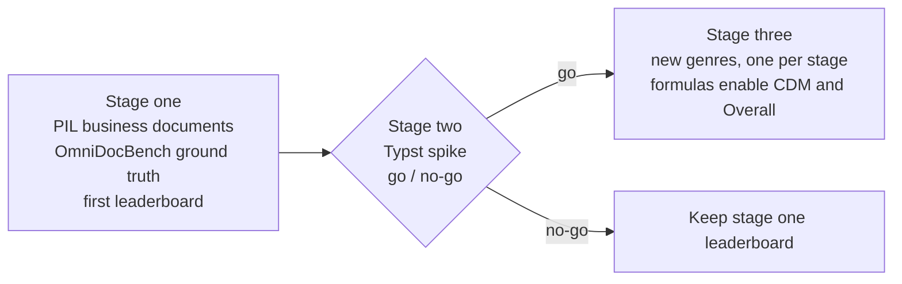
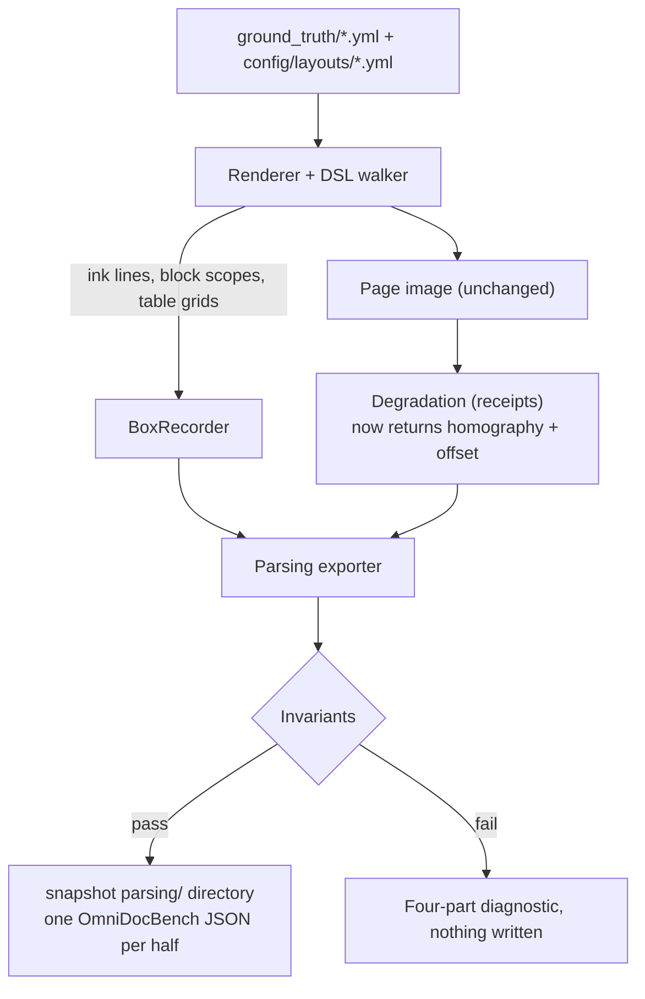

# Document Parsing Benchmark: Design Spec

> Status: approved (13 October 2026). It covers a three-stage programme; the first implementation plan
> (`docs/parsing_benchmark_stage1_plan.md`) covers **stage one only**. Stages two and three are outlined
> here so stage one's choices do not close them off, and each gets its own spec when it starts.

### Relationship to the extraction benchmark

This repository is a clone of the synthetic business-document extraction generator, with shared history,
so the extraction benchmark stays exactly as it is and nothing here can break it. The extraction
repository is the `upstream` remote, fetch only; its later fixes are brought in by cherry-pick. Within
this repository, parsing is the purpose, so parsing keys live in the layouts, parsing checks run in
`validate`, and the snapshot carries the parsing ground truth.

---

## 1. Goal

Turn the generator into a **general document parsing benchmark** for tools such as MinerU, Docling and
Marker: a leaderboard that scores how well each tool reads a page into structured markdown (text,
tables, reading order) and, secondarily, where it places and how it classifies each region.

Two principles carry over unchanged from the extraction benchmark:

- **Ground truth is authored, not annotated.** Every block, its text, its category, its order and every
  table cell is recorded at draw time by the code that drew it, so it is exact by construction and
  checkable by invariants.
- **Published metrics, published scorer.** The benchmark scores with OmniDocBench's evaluation protocol
  and its Apache-2.0 evaluation code, pinned and unmodified. This repository writes ground truth in
  OmniDocBench's JSON format; it does not write a scorer.

### Non-goals

- A bespoke metric, or a fork of the evaluator.
- Formula scoring, and therefore the published Overall score, before stage three.
- Multi-page documents and PDF inputs before stage two.
- Re-rendering or reseeding the existing corpus. Stage one adds ground truth to the pages the snapshot
  already ships, which stay byte-identical.

---

## 2. Programme

| Stage | Renderer | Pages | Delivers |
|---|---|---|---|
| One | PIL (existing DSL) | The snapshot's 660: plain, distractor, labelled_varied (165 each), degraded receipts (165) | Ground truth in OmniDocBench JSON; text, table and reading-order scores; layout ground truth ready for detection scoring |
| Two | Typst (spike) | One multi-page genre | Proof that Typst yields exact block and word ground truth, PDF and image inputs; go/no-go |
| Three | Typst | New genres | Genre breadth, digital-PDF inputs, formulas |

---

## 3. Metrics (OmniDocBench protocol)

| Metric | Published as | Status | Needs from each tool |
|---|---|---|---|
| Full-page text | Normalised edit distance (with BLEU, METEOR) | Primary, stage one | Per-page markdown only |
| Table structure | TEDS and TEDS-S (Zhong et al. 2020) | Primary, stage one | Per-page markdown or HTML tables only |
| Reading order | Edit distance over block order | Primary, stage one | Per-page markdown only |
| Layout detection | COCO mAP / mAR | Secondary; ground truth in stage one, per-tool box adapters after the primary scores work | Boxes in COCO form, via one adapter per tool |
| Formulas | CDM and edit distance | Stage three | Per-page markdown only |
| Overall | Mean of (1 - text edit distance) x 100, table TEDS, formula CDM | Stage three | Derived |

Until formulas exist the leaderboard reports the components separately and leaves Overall blank; it
never substitutes a two-component average.

---

## 4. Stage one: ground truth for the PIL business documents

### 4.1 Flow

Parsing ground truth needs a render, so it is produced by `eval-set`, not by `derive`. The snapshot gains
a `parsing/` directory beside `geometry/`, named by a new key beside `geometry_dir` in
`config/generation_config.yml`, holding one JSON file per half: `plain.json`, `distractor.json`,
`labelled_varied.json`, `degraded.json`. `MANIFEST.json`, `SHA256SUMS` and the generated README cover
them. Images are not duplicated: each page's `page_info.image_path` points at the half's existing image.

### 4.2 Blocks

- **Unit.** Each leaf content primitive (`text`, `pair`, `block`, `table`, `banner`, `logo`, `barcode`,
  `qrcode`) opens one block scope; every ink record drawn inside it carries that block's id. Containers
  (`stack`, `panel`, `split`) only position, and `spacer` draws no text. A `rule` draws none either,
  unless it has a `fill_char` (receipts set `rule_fill_char: "-"`; the invoice tear line uses one): it then
  draws a line of separator glyphs through `draw_separator`, which records no ink, so stage one's ground
  truth does not contain it.
- **Grouping override.** A container may declare `parse_block: true`, making everything beneath it one
  block (a key-value panel a parser naturally reads as one paragraph). The default grouping is fixed by
  the matcher check (section 5.3), not decided in advance.
- **Category.** A new `config/parsing_config.yml` carries a required `category_map` from every DSL
  primitive and every overlay type (`stamp`, `highlight`, `ink_marks`, `handwriting`) to an OmniDocBench
  category. A block may override its category with `parse_category:`, for example the 'TAX INVOICE'
  heading `text` as `title`. `category_map` has three required sub-maps: `primitives` (every DSL
  primitive that opens a block), `overlays` (every registered overlay type) and `anchors`, which
  overrides the primitive's category by block anchor (`foot: footer`). Precedence, highest first:
  `parse_category:`, then `anchors`, then `primitives`. Starting values:

  | Source | Category |
  |---|---|
  | `banner` | `title` |
  | `text`, `pair`, `block` | `text_block` |
  | `table` | `table` |
  | `logo`, `barcode`, `qrcode` | `figure` |
  | foot-anchored blocks | `footer` |
  | overlay `stamp`, `handwriting` text | `text_block` |
  | overlay `ink_marks` pen strokes, `highlight` | `abandon` |

- **Reading order.** Block draw order: column by column within a `split`, overlay marks last. A block
  may override it with `parse_order:`, used only where the matcher check shows draw order misreads.
- **Joined tables.** A `table` may declare `parse_join: previous_table` (the key's one value, refused on
  any other primitive): its rows are written as the last rows of the nearest table written before it, as
  section 4.3 describes. The bank statement totals table carries it (section 5.3, recommendation 7).
- **Text.** A block's ink lines joined in draw order, exactly as drawn. Distractor text is ordinary text
  here: a parser should read it.
- **Boxes.** Each block's `poly` is the union of its ink boxes as four corners in pixels.
- **Page attributes.** `page_info.page_attribute` carries document type, layout id, half and degradation
  tier, so the evaluator's per-attribute breakdowns slice by them.

### 4.3 Tables

`primitives_table.py` already computes every row band and column anchor; it now records the grid as it
draws, and the exporter writes it as the block's `html`:

- header rows are ordinary rows;
- date sub-header rows (`dedicated_row` grouping) span every column with `colspan`;
- synthetic rows (opening and carried-forward balances) are real rows, because they are printed;
- a row's sub-lines stay inside their parent cell;
- `capture: false` suppresses scored-field boxes only, never the grid;
- a table with `parse_join: previous_table` has no block of its own in the page: its rows follow the
  nearest earlier table's, each of its cells in that table's column whose horizontal span (the union of
  the column's cell ink) best overlaps the cell's ink, so every row still has that table's N columns, and
  its ink widens that table's `poly`. A join with no table before it is refused four-part.

### 4.4 Degraded receipts

`generators/degradation/camera.py` computes the homography `m` and the padding offset, then discards
them. It now returns both, and the exporter pushes each block's corners through them, so every `poly`
is a true quadrilateral in the photographed frame and `page_info` carries the frame's size. Text,
tables and reading order need no transform: they are scored from markdown.

**Known gap.** The heavy tier's Augraphy `Folding` displaces pixels locally, which no homography models.
A fiducial test measures the worst displacement. If it exceeds `fold_displacement_max_px` in
`config/parsing_config.yml`, heavy-tier pages are excluded from layout detection scoring only, and the
manifest records the exclusion.

---

## 5. Validation, evaluation and runs

### 5.1 Invariants

Checked by `validate` and again by `eval-set`; each failure is fail-fast with the four-part diagnostic
(what, where, expected, recover) and nothing is written.

1. Every ink record belongs to exactly one block: none orphaned, none owned twice.
2. A block's `text` equals its ink lines joined in draw order; a table's cell texts, as a multiset, equal
   the ink drawn inside its cells.
3. Every scored field value appears verbatim in some block's text.
4. Every `poly` lies within its page (degraded: within the frame).
5. `category_map` covers every primitive and overlay type in use, and every value is in the
   OmniDocBench vocabulary, which `config/parsing_config.yml` lists beside the pinned evaluator commit.

### 5.2 Evaluator

- OmniDocBench is pinned by repository URL and commit in `config/parsing_config.yml`; it is checked out
  beside the repository, never vendored.
- It runs locally in its own conda environment file, so its dependencies never enter the main
  environment.
- Formula metrics are switched off in its committed configuration; stage one needs no LaTeX toolchain.
- **Perfect-score check.** A test-only converter turns ground truth into per-page markdown; scored by the
  pinned evaluator it must give text edit distance 0, TEDS 1 and reading-order edit distance 0. This
  proves the export and the evaluator agree on the format, which no invariant can.

### 5.3 Matcher check (first task of stage one, and a gate)

OmniDocBench matches markdown to ground-truth blocks with an algorithm tuned on papers and books. Before
building the rest, export about a dozen pages (two layouts per type, plus degraded receipts), run MinerU,
score, and inspect the matches. The findings fix the default block grouping and any `parse_order:`
overrides, and are recorded in this document. If the matcher misbehaves on these layouts in a way
grouping cannot fix, stop and revisit the design.

**Perfect-score findings.** Scoring the six clean probe pages' own ground truth, written back as markdown,
with the pinned evaluator gave text edit distance 0, table TEDS 1 (structure-only TEDS 1) and table edit
distance 0 at once: the text and table formats agree, and `.png` pages pair with `<stem>.md` predictions.
Reading order did not, for two reasons:

- *Order counts from 1.* OmniDocBench numbers its own pages' `order` from 1, and its matcher reads an
  order of 0 as no order at all (it falls back to an absent position and then drops it). A 0-based first
  block therefore left the reading order unscored. The writer now numbers from 1 (Decision 6).
- *The first predicted table loses its position.* At the pinned commit, and on upstream main too, the
  table matcher records a matched prediction's position only when its index is truthy
  (`src/core/matching/match.py` line 714, `... if pred_idx else ""`; line 713 drops its category the same
  way), so the table matched to prediction index 0, the first table of the page, drops out of the
  predicted order while its ground truth stays in. The effect is one edit on every page whose first
  predicted table matches at index 0, even when the prediction is perfect (0.062 over the probe, where
  every page has one table). It falls equally on every tool scored, and on upstream's published numbers.

  Two ways to treat it: (B) run the evaluator through a launcher that restores that one position before
  calling the evaluator's own entry point, leaving the checkout pinned and untouched; a prototype scored
  the probe perfectly on all five numbers (text edit distance 0, TEDS 1, structure-only TEDS 1, table edit
  distance 0, reading-order edit distance 0), so this defect is the only remaining cause, but reading-order
  numbers would then differ from upstream's. (C) run the evaluator unmodified, so numbers stay comparable
  with upstream's, and have the perfect-score test assert reading order exactly up to the artefact: per
  page, the predicted order equals the ground-truth order less that table's position, and the aggregate
  equals the value the artefact predicts. Stage one runs C; whether to adopt B is decided at the matcher
  gate.

**Gate notes.** Two items are left for the matcher gate.

- *Unrecorded separator glyphs.* The lines of separator glyphs described in section 4.2 record no ink, so
  a parser may transcribe them, which raises text edit distance on every receipt and on invoices with the
  tear line. Options: record them as a textless `abandon` block, record them as text, or leave them out.
  Decided at the matcher gate.
- *Code primitives in a foot-anchored stack.* A barcode, logo or QR code inside a foot-anchored stack
  categorises as `footer`, because the anchor outranks the primitive; the invoice remittance barcode is
  one, and its text is then its caption digits. Options: let code primitives keep `figure`, or leave as
  is. Decided at the matcher gate.

**Matcher check, 13 October 2026.** The six clean probe pages were parsed locally on an Apple M1 Pro
(16 GB) and scored with the pinned evaluator, unmodified (option C above). The runbook records the
commands.

- *Tools.* MinerU 3.4.5, pipeline back-end (PDF-Extract-Kit-1.0 weights), on `mps`. Docling 2.120.2,
  standard pipeline with its default settings: layout (Heron) and TableFormer models on `mps`, RapidOCR
  (PP-OCRv6, torch) on the CPU.
- *Headline scores* (`ALL_page_avg`; reading order includes the known one-edit artefact on every page
  whose first table matched):

  | Tool | Text edit | Table TEDS | TEDS structure-only | Table edit | Reading-order edit |
  |---|---|---|---|---|---|
  | MinerU pipeline | 0.475 | 0.439 | 0.473 | 0.386 | 0.429 |
  | Docling | 0.384 | 0.391 | 0.395 | 0.733 | 0.365 |

- *Aside.* Docling's VLM pipeline with the GraniteDocling 258M preset (MLX, `mps`) was also run. It
  emitted no table on any page and dropped most of both bank statements (text 0.232, TEDS 0, table edit
  1.0, reading order 0.458); its low text edit is an artefact of a missing table being charged to the
  table metric only. It is not the configured Docling tool and is not used below.

What the matcher handles well:

- *Line-level blocks, either way round.* Where a parser emits one paragraph per printed line (MinerU on
  both receipts and the invoice supplier block), blocks match one to one at edit 0. Where it emits one
  paragraph for many lines, the matcher merges consecutive ground-truth blocks into it: Docling's
  supplier paragraphs on both invoices took four and five blocks at edit 0, and Docling's single
  paragraph for the whole top half of a receipt took twenty-two to twenty-nine blocks at once (edit 0.16
  and 0.27, almost all of it the item table's text, which Docling wrote into the paragraph). A parser's
  split of one line (label left, amount right) is merged back too. On the one page both a parser and
  the matcher got right (Docling on the GST-inclusive invoice) text edit was 0.014 and TEDS 1. The
  default line-level grouping therefore needs no `parse_block` to be fair to either style.
- *Normalisation.* The evaluator strips spaces and punctuation before text edit distance, so separator
  dashes that a parser transcribes cost nothing, nor do markdown escapes such as MinerU's backslash
  before a currency sign, nor doubled spaces in ground truth.
- *`<td>`-only tables under TEDS* (Decision 7). A receipt item table that MinerU read correctly, given as
  html, scored TEDS 1 and structure-only TEDS 1; an invoice item table that Docling read correctly, given
  as a markdown pipe table with a header separator, also scored TEDS 1. Header-less, `<td>`-only ground
  truth scores as intended against both output forms.

What goes wrong, and why:

- *Table edit distance depends on the output form.* The evaluator turns a markdown pipe table into html
  with `colspan="1" rowspan="1"` on every cell, and table edit distance compares html strings, so
  Docling's perfect invoice table scored TEDS 1 but table edit 0.50. Html emitters (MinerU) carry no such
  attributes. Table edit distance is therefore comparable only between tools with the same output form;
  TEDS is not affected.
- *Text next to a table is folded into it.* Both tools read the invoice payment-details and totals
  panels beneath the high-value invoice's item table as extra table rows (MinerU on the other invoice
  too), and both read the bank statement's separate one-row totals table as more rows of the
  transaction table or as loose text. Docling also folded the statement's account-holder and
  account-number panels into the table as a spanning first row. The matcher does not match across the
  table and text categories, so the folded ground-truth text blocks go unmatched (edit 1 each), the
  totals table goes unmatched (TEDS 0 on every statement, both tools) and the main table loses TEDS for
  the extra rows (high-value invoice 0.36 and 0.47). This is a parser reading, not a matcher fault, and
  no `parse_*` key can change it, because `parse_block` refuses tables.
- *Receipt item tables read as text.* Docling never found a table on a receipt: its layout model saw the
  receipt as one text region, so the item table goes unmatched (TEDS 0) while its text inflates the
  neighbouring text match.
- *Wrapped description lines become rows.* Ground truth keeps a transaction's second description line
  inside its parent cell (section 4.3); both tools emit it as a row of its own, which costs
  TEDS on every wrapped transaction (statement tables 0.71 to 0.88).
- *Top-of-page text.* MinerU classes the statement banner and account panels, and the invoice contact
  strip (and, on one invoice, the heading), as page header and leaves them out of its markdown; Docling
  transcribes the contact strip (and, on one statement, the banner) but folds the statement account
  panels into the table. Either way the statement account panels go unmatched, which drives text edit
  on the statements (MinerU 0.81 and 0.83 per page, Docling 0.78 and 0.81).
- *Overlay text split in two.* A stamp's two lines are one ground-truth block; Docling writes them as two
  separate paragraphs with other text between them, and the matcher merges only adjacent predictions,
  so the block matches half its text (edit 0.50 on both invoices).
- *Leftovers are paired, not dropped.* Unmatched ground-truth blocks are paired with whatever predicted
  text remains: a barcode's printed digits, a `<!-- image -->` placeholder, or a stray table cell. The
  evaluator's table-formula rescue also turns date cells of a predicted table into formula items, which
  then pair with unmatched statement header blocks. The edit charged is the same as for an unmatched
  block, but the pairing is misleading when reading per-block output, and it feeds the reading-order
  score.
- *Code primitives.* Both receipt barcodes have digits printed beneath them; MinerU transcribes both
  and Docling one. A receipt barcode is a `figure`, so those digits are spare predicted text (see the
  previous item). No probe invoice carries the remittance barcode, but the evaluator ignores the `footer`
  category together with whatever is matched to it (`src/core/matching/match_quick.py`, its ignore
  list), so a foot-anchored barcode's caption digits would cost nothing either way.
- *Ignored categories are matched first.* At the pinned commit the quick matcher
  (`src/core/matching/match_quick.py`) first pairs every ground-truth line in an ignored category
  (`header`, `footer`, `page_number` and the caption and footnote categories) with every prediction
  whose normalised edit distance to it is below 0.25, and removes those predictions before the scored
  blocks are matched. An ignored line therefore costs nothing itself but can take a prediction that
  belongs to a scored block close to it. This bears on any `header` or `footer` category. Measured on
  the probe with the evaluator's own normalisation: the statement banner is at least 0.95 from every
  scored line; the closest footer line (an invoice's website line in the foot band) is 0.32 from the
  nearest scored line (the contact email line); the page-number footer is 0.75 or more from every
  scored line. No footer line on the probe is within 0.25 of a scored line, but the website line's
  margin is small, because the business domain recurs across lines.

Recommendations for the owner (each to accept or reject):

1. Keep line-level blocks as the default and add no `parse_block`: the matcher merges them into
   paragraph-style predictions at no cost (accepted).
2. `parse_category: title` on the invoice 'TAX INVOICE' heading: both tools render it as a markdown
   heading on at least one invoice; this changes only the per-category breakdown (accepted).
3. `parse_category: header` on the invoice contact strip above the heading and on the statement banner:
   they are running page furniture, and OmniDocBench's own pages label such text `header`, which it
   ignores. MinerU omits them and Docling reads them, so this is neutral between tools rather than a
   fix. The statement account-holder and account-number panels carry scored fields and stay
   `text_block`, although both tools currently lose them (accepted for the statement banner; withdrawn
   for the invoice contact strip, see below).
4. No `parse_order`: no page showed a draw-order misread; reading-order cost came from missing and
   folded blocks, not from the ground-truth order (accepted).
5. Separator glyphs: leave them out of ground truth; normalisation makes them free (accepted).
6. Code primitives: keep `figure` for receipts and `footer` for the foot-anchored invoice barcode, and
   accept the spare caption digits on receipts; recording the digits as their own `text_block` would
   reward every parser for them and is the alternative (accepted).
7. Bank statement totals row: no layout key fixes it. Writing it as the transaction table's last row
   instead of a table of its own would match how both tools read it; it needs a writer change, which
   no existing layout key makes, and is the owner's call (accepted).
8. Leaderboard: lead with TEDS for tables and report table edit distance beside it with the output-form
   caveat above (accepted).
9. Reading-order artefact: keep option C; the probe gave no reason to patch the evaluator (accepted).

#### Owner decision, 13 October 2026

Go. All nine recommendations accepted.

| No. | Recommendation | Decision | How it is realised | Where |
|---|---|---|---|---|
| 1 | Line-level blocks, no `parse_block` | Accepted | No change: line-level grouping is the default (plan Decision 1) | None |
| 2 | `title` on the 'TAX INVOICE' heading | Accepted | `parse_category: title` on the heading `text` block of every invoice layout | `config/layouts/invoices.yml`: `_invoice_title`, `_trade_title`, `_professional_parties`, `_wholesale_seller`, `_subscription_header`; `tests/parsing/test_layout_parse_keys.py` |
| 3 | `header` on the invoice contact strip and the statement banner | Accepted for the statement banner; withdrawn for the invoice contact strip after implementation | `parse_category: header` on the statement `banner`. The contact strip stays `text_block`: the quick matcher removes every prediction within normalised edit distance 0.25 of an ignored line (see *Ignored categories are matched first* above), and the contact email line and the scored PayID line on the same business domain are 0.24 apart, so a `header` contact email swallowed the PayID prediction for every parser and the perfect-score check failed | `config/layouts/bank_statements.yml`: the `banner` in `_anz_standard_body` and `_anz_modern_body`; `tests/parsing/test_layout_parse_keys.py` (the banner is a `header`; no invoice block is) |
| 4 | No `parse_order` | Accepted | No change: draw order stands | None |
| 5 | Separator glyphs left out | Accepted | No change: rule fill glyphs stay unrecorded (section 4.2) | None |
| 6 | Code primitives keep `figure`, or `footer` when foot-anchored | Accepted | No change: the category precedence of plan Decision 5 stands | None |
| 7 | Statement totals joined to the transaction table | Accepted | New table key `parse_join: previous_table` (plan Decision 17; sections 4.2 and 4.3), set on the totals table | `generators/layout_dsl/schema.py`, `generators/parsing/config.py` (`layout_parse_errors`), `generators/exporters/geometry.py` (`BlockRecord.join`), `generators/parsing/omnidocbench.py`; `config/layouts/bank_statements.yml`: the `bank_transaction_totals` table in `_anz_standard_body` and `_anz_modern_body`; `tests/parsing/test_omnidocbench.py`, `tests/parsing/test_layout_parse_keys.py`, `tests/layout_dsl/test_schema_parse_keys.py` |
| 8 | Leaderboard leads with TEDS, table edit distance beside it with the output-form caveat | Accepted | Carried into the first leaderboard | Plan Task 8, `scripts/score_parsing.py` |
| 9 | Evaluator left unpatched (option C) | Accepted | No change: the perfect-score test keeps asserting the reading-order artefact | `tests/parsing/test_perfect_score.py` |

### 5.4 Parser runs

- `config/parsing_config.yml` lists each tool with its back-end, its runner (`local` or `remote`) and,
  for local tools, its conda environment file. Initial list:

  | Tool | Runner |
  |---|---|
  | MinerU, pipeline back-end | remote GPU |
  | MinerU, VLM back-end | remote GPU |
  | Docling | local (Apple Silicon) |
  | Marker | local (Apple Silicon) |

- Each tool writes one markdown file per page to
  `../evaluation_data/predictions/<tool>/<half>/`, named as OmniDocBench expects; local and remote runs
  are indistinguishable to scoring.
- A new runbook, `docs/parsing_benchmark_runbook.md`, covers the remote runs.
- A `score` step runs the evaluator per half and writes the leaderboard: per half, per document type,
  per degradation tier, with each run's device recorded.
- Marker's model-weight licence is read and recorded before its scores are published; Docling is MIT.

### 5.5 Configuration

Every key in `config/parsing_config.yml` is required; a missing or invalid key fails at startup with the
four-part diagnostic. Keys: `evaluator` (`repo`, `commit`, `conda_env_file`, `formula_metrics: false`),
`category_vocabulary`, `category_map`, `fold_displacement_max_px`, `tools`.

### 5.6 Tests

Mirroring the source tree, test first:

- `tests/layout_dsl/`: block scopes per primitive, `parse_block`, `parse_category`, `parse_order`,
  `parse_join`;
- the table grid, including `colspan` sub-headers, synthetic rows and sub-lines;
- `tests/exporters/`: the OmniDocBench writer, every invariant, the perfect-score check;
- `tests/degradation/`: homography round trip, fold fiducial;
- `tests/snapshot/`: the `parsing/` directory in the manifest and checksums;
- every diagnostic through `assert_diagnostic_error`. Coverage stays at or above 80%.

---

## 6. Stage two: Typst spike (outline)

One multi-page document with two-column flowing text, a table broken across a page, running headers and
footers, and a captioned figure, output as a PDF with a text layer and as 300 dpi PNGs rasterised from
it. It passes the gate when:

1. block ground truth comes from Typst introspection (`typst eval` over labelled metadata, with the
   baseline correction recorded in `docs/pipeline_backend_comparison.md`);
2. word and line boxes come from the PDF text layer via `pypdfium2` (permissively licensed; PyMuPDF is
   AGPL and excluded);
3. every block's text equals the words inside its box, on every page;
4. the tagged-PDF structure tree, if the pinned Typst writes one, agrees on order;
5. the output passes through the stage-one exporter and the perfect-score check;
6. two renders are byte-identical.

The stage adds a digital-PDF versus image input condition, which exercises MinerU's text-layer path for
the first time. On a no-go the stage-one leaderboard stands alone.

---

## 7. Stage three: new genres (outline)

One genre per stage, each with its own spec. Business-adjacent genres first, because they reuse
`content_engine`: multi-page statements, purchase orders, remittance advices, annual-report financial
tables. Then genres needing new content: reports, then a formula-bearing genre whose formulas are
authored in LaTeX and rendered through `mitex`, which enables CDM and the Overall score.

How prose and formula content is sourced (public domain, generated on the remote server, or
share-alike licensed) is decided in that stage's spec, because it binds the published dataset's licence.
Porting the business layouts to Typst, giving PDF versions of the existing 165 cases from the same YAML,
is optional within this stage.

---

## 8. Key files (stage one)

| File | Change |
|---|---|
| `generators/exporters/geometry.py` | Block records, block ids on ink, table grids |
| `generators/layout_dsl/engine.py` | Block scope per leaf primitive; `parse_*` keys |
| `generators/layout_dsl/primitives_table.py` | Record the cell grid |
| `generators/layout_dsl/schema.py` | Validate `parse_block`, `parse_category`, `parse_order`, `parse_join` |
| `generators/overlay/engine.py` | Overlay ink joins blocks by overlay type |
| `generators/degradation/camera.py` | Return homography and offset |
| `generators/exporters/omnidocbench.py` (new) | Ground truth writer and invariants |
| `generators/snapshot/export.py` | Write `parsing/`, manifest, checksums, README |
| `config/parsing_config.yml` (new) | Evaluator pin, vocabulary, category map, tools |
| `config/generation_config.yml` | `parsing_dir` beside `geometry_dir` |
| `docs/parsing_benchmark_runbook.md` (new) | Parser runs and scoring |
