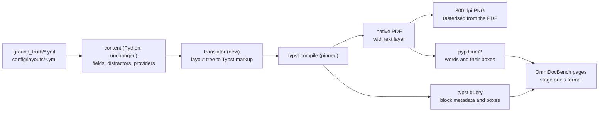

# Parsing Benchmark, Stage 2: Native PDFs Typeset with Typst

> Status: design agreed with the project owner, 15 October 2026; awaiting review of this written spec.
> It replaces the stage-two outline in section 6 of
> [`parsing_benchmark_design.md`](parsing_benchmark_design.md), which proposed a new multi-page genre.

## 1. Why, and what decision it serves

About half of the documents the benchmark's users receive are native PDFs: files with a text layer,
made by accounting or banking software, not scans or photographs. Stage one scores parsers on images
only, so every tool must recognise characters before it can lay a page out, and its scores mix the two
skills. A native PDF hands a parser the characters, and what remains is layout, tables and reading order.
A tool's ranking can change between the two inputs.

Stage two lets the owner **pick the parser for native PDFs**, and decide whether native PDFs should take
a different route from scanned ones, for instance a near-instant text-layer extraction instead of a
model taking 30 seconds a page.

The native PDFs users receive are mostly the same kinds as stage one's (bank statements, receipts, tax
invoices) and mostly one page long. Stage two therefore keeps stage one's documents and content, and
changes how pages are made: they are **typeset by Typst into native PDFs**, because typeset PDFs look
like those real software produces, where stage one's pages are drawn pixel by pixel.

### Non-goals

- Multi-page documents and new document kinds (stage three).
- Re-making the photographed receipts: a photograph is an image by nature, so stage one's degraded half
  stands.
- The labelled_varied half: it serves the extraction benchmark and tells parsing little.
- Any change to the PIL renderer, its pages or stage one's scores.

## 2. Shape

| Set | Pages | Inputs | Ground truth |
|---|---|---|---|
| `typeset_plain` | 165: 55 bank statements, 55 receipts, 55 tax invoices | Each page as native PDF and as a 300 dpi PNG rasterised from it | `parsing/typeset_plain.json`, one page per document, shared by both inputs |
| `typeset_distractor` | The same 165 documents with their distractors | The same | `parsing/typeset_distractor.json` |

The PNG is rasterised from the very PDF it pairs with, so the image and the PDF are the same page and
the comparison isolates the input format.

## 3. The translator

- **One source of layouts.** The YAML layouts under `config/layouts/` stay the single source; nothing is
  ported by hand. A new package, `generators/typst/`, holds a translator that walks a layout's tree, with
  the entry's values already chosen by today's Python, and writes Typst markup.
- **One function per primitive.** A shared template, `generators/typst/template.typ`, defines a Typst
  function for each of the 17 primitive types the layouts use (`text`, `spacer`, `split`, `pair`, `stack`,
  `rule`, `table`, `panel`, `logo`, `block`, `barcode`, `highlight`, `handwriting`, `banner`, `stamp`,
  `qrcode`, `ink_marks`). A layout using a primitive the translator does not know is refused with the
  four-part diagnostic (what, where, expected, recover), never skipped.
- **Content is unchanged.** Field values, distractor values and placements, and every field provider are
  chosen exactly as for the PIL render, so a typeset page carries the same text as its stage-one twin.
- **Physical page sizes.** Each layout gains a required key giving its physical page: A4 for invoices and
  bank statements, a roll width in millimetres with content-driven height for receipts (stage one's
  receipts are 310, 420 and 440 px wide, with no physical size recorded). The key is required on every
  layout, and a missing one fails `validate` with the four-part diagnostic; no width is assumed in Python.
- **Fonts.** Typst compiles with `--font-path fonts --ignore-system-fonts`, so only the repository's own
  TTF faces (Carlito, Liberation, and the handwriting faces) are used and every machine typesets alike.
- **Typesetting replaces pixel fitting.** Stage one fits each field to a pixel budget by shrinking or
  wrapping. Typst wraps text within its column. The fit rule becomes a check on the compiled page (section
  4): no block may run off its page or its column, or overlap a neighbour.
- **Codes and logos** are computed in Python as today (Code 128 bars, QR modules) and typeset as vector
  shapes; logos stay simple vector shapes with text initials.
- **Overlays** (handwriting, ink marks and highlights on bank statements, the paid stamp on invoices) are
  drawn as today by the overlay code, as transparent images, and placed in the PDF as images, as real
  annotated PDFs carry them. They have no text layer; a parser must read them from pixels, as it would in
  a real file. They occur in `typeset_distractor` only, since only distractor keys switch them on.
- **Ligatures off.** `#set text(ligatures: false)`, so the text layer holds the letters the ground truth
  records. The feasibility gate (section 7) also compiles with ligatures on, to record whether the
  text layer maps them back cleanly; turning them on is a later, separate decision.
- **Reproducible.** Every compile passes a fixed `--creation-timestamp`, and two compiles of one page must
  be byte-identical.
- **Pinned.** Typst (Apache-2.0) and `pypdfium2` (Apache-2.0 or BSD-3-Clause, over PDFium's BSD-3-Clause)
  enter `environment.yml` at exact versions. PyMuPDF is excluded: it is AGPL.

## 4. Ground truth and checks

**Blocks.** Every scored block in the markup is wrapped with a label and a `metadata` value carrying its
block id, OmniDocBench category and reading-order rank, which the layout's `parse_block`,
`parse_category`, `parse_order` and `parse_join` keys decide exactly as in stage one. A `typst query`
over those labels returns each block's page position and measured size, and so its box.

**Words.** `pypdfium2` reads the compiled PDF's text layer: every word with its box, exactly what a parser
in PDF mode receives.

**Joining them.** Words are assigned to blocks by containment. A block's text is its words in reading
order, joined as stage one joins ink lines; a table's html is rebuilt cell by cell from the cells' boxes.
Boxes are kept in PDF points and scaled by 300/72 for the PNG, so one ground truth serves both inputs.

**Page checks.** Stage one's six invariants carry over, now proven against the PDF itself, in `validate`
and again in the export, each failure refusing the page with the four-part diagnostic:

1. every word of the text layer belongs to exactly one block;
2. a block's text equals its words in order, and a table's cells hold exactly the words inside them;
3. every scored value appears verbatim in some block;
4. every box lies within its page;
5. every category is in OmniDocBench's vocabulary;
6. no block in an ignored category lies within the evaluator's ignored-match distance of a scored block.

Invariant 1 is the guard against the text layer holding text the ground truth does not know about.

**Layout checks** (new): no block's box runs off its page or out of its column, and no two blocks' boxes
overlap, except an overlay over the page beneath it.

**Distractor checks.** Density (the share of the page distractors cover) and overlay placement (no
overlay covers a scored field) are measured on Typst's boxes instead of PIL's ink. Checks on content, such
as a distractor never reproducing a scored value, run unchanged, since they do not depend on drawing.

## 5. Snapshot and publication

- `eval-set` gains the two sets: `typeset_plain_<YYYYMMDD>/` and `typeset_distractor_<YYYYMMDD>/`, each
  holding `CASE001_invoice.pdf` beside `CASE001_invoice.png` and so on, the set's `ground_truth.csv` and
  `.jsonl` (the same values as stage one's), and `parsing/typeset_plain.json` and
  `parsing/typeset_distractor.json`. The manifest, checksums and `verify_snapshot.py` cover the PDFs.
- **The publication scan reads PDFs.** It reads every non-image file as text today, so it would refuse a
  PDF. It gains a PDF reader (`pypdfium2`) that scans each PDF's metadata and text layer for the
  forbidden terms and the internal layout ids.
- **Producer field.** Typst writes its name into each PDF's Producer field. Whether to blank it or to
  accept that the PDFs say they were made with Typst is the owner's decision, made before the first
  export and recorded in the generation config, never defaulted in Python.

## 6. Runs and scoring

- **Input choice.** `scripts/run_local_parser.py` gains a required `--input pdf|png`. Each parser runs in
  its own default PDF mode, as a user would run it: MinerU's `pipeline` and Docling read the text layer;
  Marker uses its own PDF text extraction. MinerU's `vlm-engine` renders every page to an image
  internally, so for it PDF input mainly tests that a PDF is handled cleanly; the leaderboard says so.
- **Text-layer baseline.** A fifth entry, `text_layer`, extracts each PDF's text with `pypdfium2` and no
  model, one paragraph per text line, PDF input only. It answers the routing question: if it comes close
  to the parsers on native PDFs, those documents can take a near-instant route.
- **Runs.** 4 parsers x 2 sets x 2 inputs = 16 runs, plus the baseline's 2. Roughly 20 to 30 hours on the
  stage-one laptop (Apple M1 Pro, 16 GB), mostly Marker and MinerU's `vlm-engine` on images; one tool at a
  time.
- **Scoring.** The pinned OmniDocBench evaluator, unmodified, as in stage one. The leaderboard gains a
  column per set and input, and a **native-PDF gain** per tool and set: its PDF score less its image
  score, signed so that positive means the PDF helped.

## 7. Feasibility gate

Before any layout beyond the first three is translated, one layout of each type (one bank statement, one
receipt, one invoice) goes end to end, and stage two continues only if all hold:

1. `typst query` reports every block's box;
2. the text layer matches the ground truth word for word, and all six invariants hold;
3. two compiles of each page are byte-identical;
4. the evaluator scores the ground truth, given as its own prediction, perfectly on text and tables, and
   on reading order up to stage one's known index-0 artefact (one edit on a page with a table).

On a no-go, stage two falls back to mirroring stage one's PIL drawing into PDFs (a thin canvas that
draws each line to both the image and a PDF), which gives native PDFs of the same pages with less
realistic typesetting. The gate's findings are recorded in this document either way.

**Gate run, 15 October 2026: go.** `scripts/typeset_gate.py` typeset the first case of each gate layout
(one tax invoice, one 80 mm receipt, one bank statement), plain and with distractors, six pages in all.
Every page passed: every block's box was reported (read with `typst eval`, since `typst query` is
deprecated in Typst 0.15.1 and its warning would fail the page); the six invariants and the layout
checks held; each page's block texts and table html equal stage one's for the same case, block by block
(whitespace collapsed); two compiles were byte-identical; each page is one A4 page or one roll. The
evaluator scored each ground truth, given as its own prediction, perfectly, up to two evaluator
artefacts: stage one's index-0 reading-order artefact (one edit on a page with a table), and its
preprocessing, which shortens a run of underscores, so the invoice's "Amount enclosed: $ ____" line
costs an exactly predictable 0.0097 of text edit distance. With ligatures switched on, invariant 1 still
held and no ligature reached any text layer; ligatures stay off all the same (section 3).

Two findings changed the design. Stage one's sheet canvases are A4 height at 300 dpi but narrower than
A4, so invoices and bank statements convert at 300 dpi and are centred on the A4 page (scaling by width
had made pages a third taller than A4). And Typst wrapped a short receipt line ("Staff:" and the name)
where stage one had shrunk it to fit; the project owner chose shrinking, so every text line is typeset
at the size and with the line breaks stage one's fitting drew, and Typst only places it.

The gate's distractor pages carried no overlays (handwriting, ink marks, highlights, stamps), which the
next step adds; the project owner gave the go on that basis.

## 8. Tests

- Each primitive's translation, against a small fixed layout.
- Each page check and layout check, each with a negative control: a deliberately broken page that the
  check must refuse, so no check can pass vacuously.
- Byte-identical recompilation.
- The publication scan over PDFs, with a planted forbidden term and a planted layout id.
- The perfect-score check on both typeset sets.
- Stage one's whole suite stays green throughout: nothing in the PIL path changes.

## 9. Programme

1. Pin Typst and `pypdfium2`; the physical page keys on every layout.
2. Translator and template for the primitives the three gate layouts use.
3. Ground truth from `typst query` and the text layer; the six invariants and layout checks.
4. **The feasibility gate**, with the owner.
5. The remaining primitives and the other 19 layouts; distractor checks on Typst geometry.
6. Export: the two sets, the PDF publication scan, the Producer decision.
7. Runner `--input`, the text-layer baseline, the runs.
8. Scoring, the leaderboard's new columns and the native-PDF gain; README and runbook.

Each step is planned task by task in a stage-two plan written after this spec is approved.

## 10. Outcome

Stage two ran on 16 October 2026 against `snapshot_20261016`, scored with the pinned
evaluator. The figures below are from `leaderboard_20261016.md`; the [README](../README.md#native-pdfs-stage-2) has the tables and the
[runbook](parsing_benchmark_runbook.md#native-pdf-runs-16-october-2026) the commands and timings.

### What was run

The owner reduced the scope: MinerU `pipeline`, MinerU `vlm-engine` and Docling on the native PDFs of
`typeset_plain` and `typeset_distractor`; the no-model text-layer baseline (`text_layer`) on both; and one
control, Docling on the typeset PNG of `typeset_plain`. Marker was dropped from stage two by the owner's
decision: it was scored on images in stage one only, and its stage-one results stand.

### Findings

On these synthetic documents (plain, then cluttered):

- The text layer, with no model, reads text far better than every parser (text edit distance 0.009 and
  0.051, against 0.253 and 0.262 for the best parser) and keeps reading order far better (0.105 and 0.099,
  against 0.315 and 0.365 at best). It gives no table structure (TEDS 0).
- For tables, MinerU `vlm-engine` is best (TEDS 0.598 and 0.492), then Docling (0.492 and 0.461), then
  MinerU `pipeline` (0.471 and 0.428).
- MinerU `pipeline` barely improves on PDFs: text edit distance 0.619 on plain PDFs against 0.637 on plain
  images.
- The routing this suggests: for a native PDF, take text and reading order from the text layer and use a
  table model where table structure matters. This is a finding about these documents, not a claim about
  all PDFs.

### The control, and what is reported

Docling's text edit distance on the typeset PNG differs from its stage-one image score by 0.028 (0.318
against 0.290), beyond the 0.02 threshold; its table TEDS differs by 0.019 (0.443 against 0.425), within it.
The typeset render alone therefore moves text scores slightly, and a text gain would mix the change of
render with the change of input.

The owner chose to report the native-PDF scores and ranking, plus table gains only. Text gains and
reading-order gains are not reported in the README, the runbook or this document. Table gains (TEDS
headline) are reported, each labelled as measured against the tool's stage-one image score: Docling +0.068
plain and +0.011 cluttered, MinerU `pipeline` +0.012 and +0.030, MinerU `vlm-engine` -0.003 and -0.024.

### Generator follow-ups recorded during stage two

None blocks the results above; each is for a later change to the generator.

- **Receipts: an unbudgeted line overruns its half-column.** The 'Reg/Staff' line in stage one's receipts is
  not budgeted in its half-column and overruns it by 22 px on the 80 mm layout, 13 px on the 57 mm layout,
  12 px on the fuel and professional layouts and 2 px on the retail_tax and hospitality layouts.
- **One bank statement layout draws a wrapped description out of order.** On case CASE054, the last line of
  a wrapped description is drawn below its 'Ref:' sub-line.
- **The heavy degradation tier is not reproducible across processes.** Augraphy's `Folding` ignores the
  seed (as the earlier distractor-overhaul plan records), so regenerating the heavy tier gives different
  pixels.
